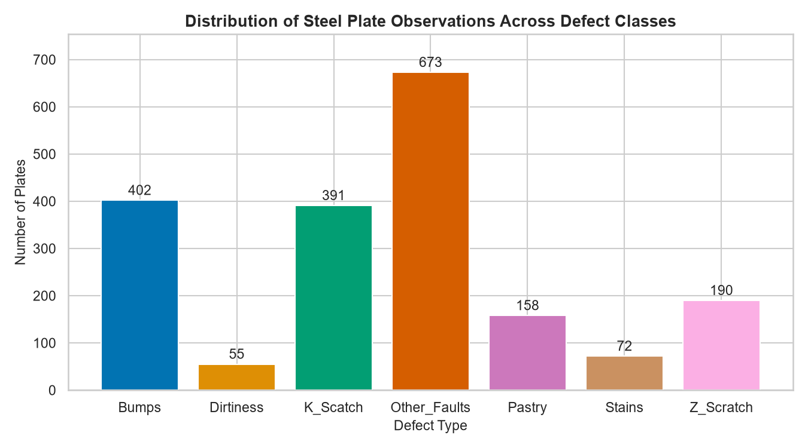
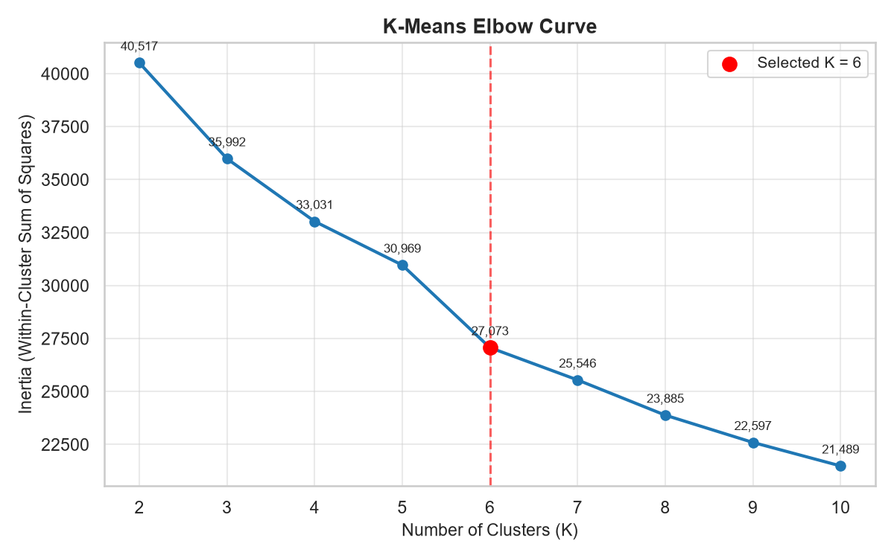
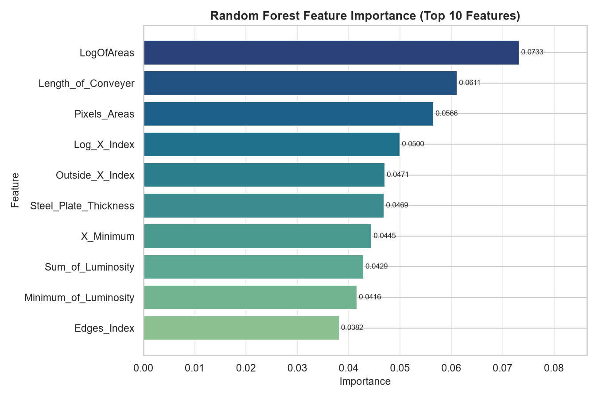
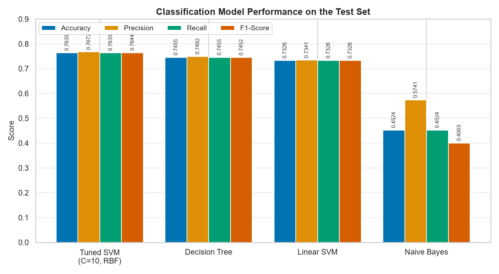
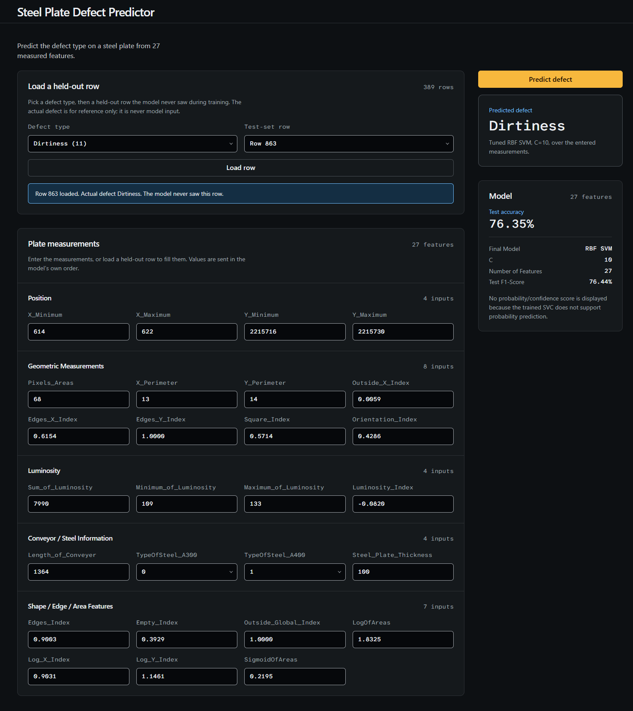

# Steel Plate Quality Control Using Machine Learning

Course project: *A Data Mining Approach to Manufacturing Quality Control: Classification and Analysis of Steel Plate Defects*.

## Overview

This project develops an end-to-end machine-learning workflow for steel plate defect analysis. Using the provided steel plate fault dataset, the project covers data understanding, preprocessing, supervised classification, SVM hyperparameter tuning, unsupervised K-Means clustering, outlier detection, and Random Forest feature importance analysis.

A tuned Support Vector Machine with an RBF kernel was selected as the final classification model. Its model and preprocessing artifacts were saved, and a reusable prediction module was implemented on top of them.

## Project Objectives

- Inspect and understand the dataset.
- Prepare the data for machine-learning analysis.
- Convert the seven binary defect indicators into a single target variable.
- Train and evaluate multiple classification models.
- Establish a Linear SVM baseline.
- Tune an SVM using cross-validation.
- Compare classification models.
- Perform K-Means clustering.
- Analyze potential outliers using multiple methods.
- Analyze feature importance using Random Forest.
- Select a final classification model.
- Save the model and preprocessing artifacts.
- Develop a reusable prediction module.

## Dataset

The initial dataset contains 1941 observations and 34 columns: numeric steel plate measurement/feature variables plus seven binary defect indicator columns.

The seven defect classes are:

- Pastry
- Z_Scratch
- K_Scatch
- Stains
- Dirtiness
- Bumps
- Other_Faults

The seven binary defect indicators were converted into a single categorical target variable, `Defect_Type`. After target construction and removal of the indicator columns, the dataset contains 1941 rows and 28 columns: 27 predictive features and 1 target variable.

- Missing values: 0
- Duplicate rows: 0
- Every observation has exactly one defect label.

Defect distribution:

| Defect Type | Count |
|---|---:|
| Pastry | 158 |
| Z_Scratch | 190 |
| K_Scatch | 391 |
| Stains | 72 |
| Dirtiness | 55 |
| Bumps | 402 |
| Other_Faults | 673 |



## Machine Learning Workflow

### 1. Data Understanding

The dataset was inspected for missing values (none found), duplicate rows (none found), data types, and descriptive statistics. The class distribution was found to be imbalanced, with `Other_Faults`, `Bumps`, and `K_Scatch` being the most frequent classes.

### 2. Data Preprocessing

The seven binary defect indicators were converted into the `Defect_Type` target, the original indicator columns were removed from the feature matrix, the data was split into features (`X`) and target (`y`), and a train/test split was performed. Feature scaling (standardization) was applied for the SVM models, and the feature order used during training was preserved for later prediction.

### 3. Classification

Four classification models were evaluated:

- Linear SVM
- Tuned RBF SVM
- Decision Tree
- Naive Bayes

### 4. Hyperparameter Tuning

The SVM was tuned using cross-validation with grid search:

- Best model: SVM
- Kernel: RBF
- C: 10
- Cross-validation F1: 0.7621

### 5. Model Comparison

The tuned RBF SVM achieved the best overall accuracy and F1-score among the evaluated classifiers and was selected as the final classification model.

### 6. K-Means Clustering

K-Means clustering was applied to explore natural groupings in the data, and the elbow method was used to examine inertia across `K`. K = 6 was selected.



### 7. Outlier Detection

Potential outliers were investigated using three complementary methods:

- Z-score
- IQR
- Isolation Forest

### 8. Feature Importance

A Random Forest model was used to estimate feature importance. The most important features included `LogOfAreas`, `Length_of_Conveyer`, `Pixels_Areas`, `Log_X_Index`, and `Outside_X_Index`. The top 10 features accounted for approximately 50.22% of the total Random Forest feature importance.



### 9. Final Model

A tuned SVM with RBF kernel and C = 10 was selected as the final classification model.

## Classification Results

| Model | Accuracy | Precision | Recall | F1-Score |
|---|---:|---:|---:|---:|
| Tuned SVM (C=10, RBF) | 0.7635 | 0.7672 | 0.7635 | 0.7644 |
| Decision Tree | 0.7455 | 0.7492 | 0.7455 | 0.7452 |
| Linear SVM | 0.7326 | 0.7341 | 0.7326 | 0.7326 |
| Naive Bayes | 0.4524 | 0.5741 | 0.4524 | 0.4003 |



The tuned RBF SVM was selected as the final classification model because it achieved the strongest overall classification performance on both accuracy and F1-score.

## Final Prediction Pipeline

The inference pipeline is:

```
User input
→ validation
→ feature ordering
→ svm_scaler.transform()
→ tuned SVM
→ predicted defect
```

The prediction implementation is in `src/predict.py`. It validates that the input is a DataFrame, that the exact required feature set is present, that all values are numeric, and that no values are missing or NaN, and it reorders features according to the saved feature list before prediction.

## Project Structure

```
steel-plate-quality-control/
│
├── api/                      # FastAPI service powering the web UI
│   ├── main.py
│   ├── requirements.txt
│   └── test_api.py
│
├── data/
│   ├── Faults.NNA
│   └── Faults27x7_var
│
├── notebooks/
│   └── steel_plate_quality_control.ipynb
│
├── outputs/
│   ├── figures/          # generated figures (report and README visuals)
│   └── models/
│       ├── feature_names.pkl
│       ├── svm_scaler.pkl
│       └── tuned_svm_model.pkl
│
├── reports/
│   └── STEEL_PLATE_QUALITY_CONTROL_LAB_REPORT.md
│
├── src/
│   ├── __init__.py
│   ├── data.py              # shared dataset loading + train/test split
│   ├── predict.py           # production inference module
│   ├── test_prediction.py
│   └── verify_model.py
│
├── frontend/                # React web UI (Vite + TypeScript + Tailwind)
│   ├── src/
│   ├── public/
│   ├── README.md
│   └── package.json
│
├── README.md
└── requirements.txt
```

## Model Artifacts

```
outputs/models/
├── tuned_svm_model.pkl
├── svm_scaler.pkl
└── feature_names.pkl
```

- `tuned_svm_model.pkl` — the final trained RBF SVM (SVC, C = 10).
- `svm_scaler.pkl` — the StandardScaler fitted on the training data, used for SVM inference.
- `feature_names.pkl` — the expected 27 feature names and their order.

> The notebook originally saved a legacy scaler fitted on the full dataset
> (`outputs/models/scaler.pkl`); it was never used for inference and has been
> removed from the repository. See the notebook's Section 12 for the full
> documentation of this historical detail.


## Limitations

- The final model achieves approximately 76% classification accuracy, so predictions are not always correct.
- The dataset has a class imbalance, and no balancing technique was applied.
- The outlier methods identify potential statistical anomalies, not guaranteed data errors or physically defective plates.
- The current SVM does not provide probability/confidence output because the saved model was trained with `probability=False`.
- The results are based on the provided dataset and should not automatically be generalized to other steel manufacturing environments.

## Lab Report

The detailed academic analysis is documented in:

`reports/STEEL_PLATE_QUALITY_CONTROL_LAB_REPORT.md`

The lab report covers the data analysis, preprocessing, model experiments, evaluation, clustering, outlier analysis, feature importance, and final model selection in detail.

## License / Academic Note

This repository represents an academic/course project demonstrating a machine-learning workflow. It is provided for educational purposes and is not licensed for commercial or production use.

## User Interface

The project ships with a web UI (FastAPI backend + React frontend) that lets you interact with the trained SVM directly.

### UI Screenshot



### Running the UI

In two separate terminals, from the project root:

```bash
# 1. Start the prediction API (port 8000)
.venv\Scripts\python.exe -m uvicorn api.main:app --port 8000

# 2. Start the React frontend (port 5173)
cd frontend
npm install
npm run dev
```

Then open `http://localhost:5173` in your browser. The frontend proxies `/api` to the FastAPI backend, so the two servers must run together.

### Using the UI

- **About the model** — expand to see the final model, kernel, hyperparameters, and test metrics.
- **Try an Example** — pick a defect type, then one of the held-out **test-set rows** (rows the model never saw during training) to load its measurements into the form. The actual defect is shown only for reference; it is never used as model input.
- **Plate Measurements** — enter (or load) the 27 measured features, grouped into Position, Geometric Measurements, Luminosity, Conveyor / Steel Information, and Shape / Edge / Area Features. Binary features (e.g. `TypeOfSteel_A300`) are offered as dropdowns.
- **Predict Defect** — runs the tuned RBF SVM on the entered measurements and displays the predicted defect class.

> Note: The model is about 76% accurate on unseen test data, so predictions are not always correct — especially on genuine test-set examples. The UI is a decision-support tool and does not provide probability/confidence output (the saved SVC was trained with `probability=False`).
