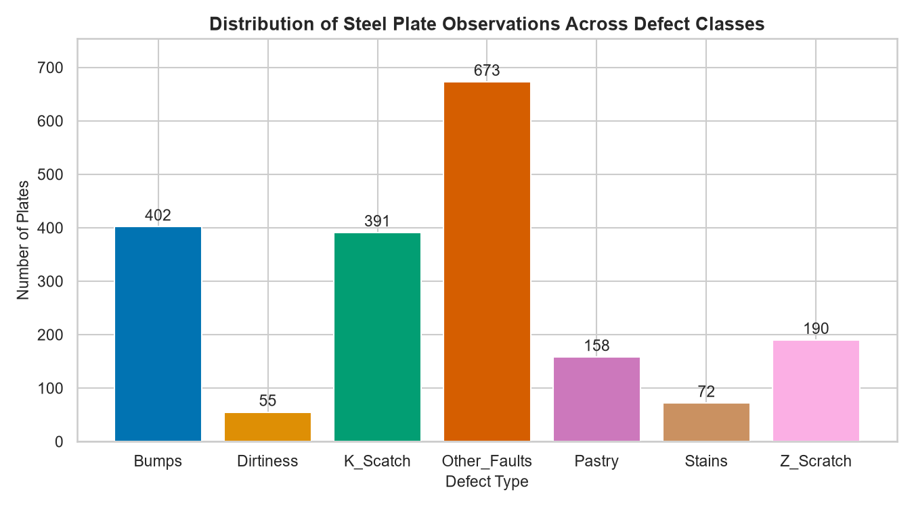
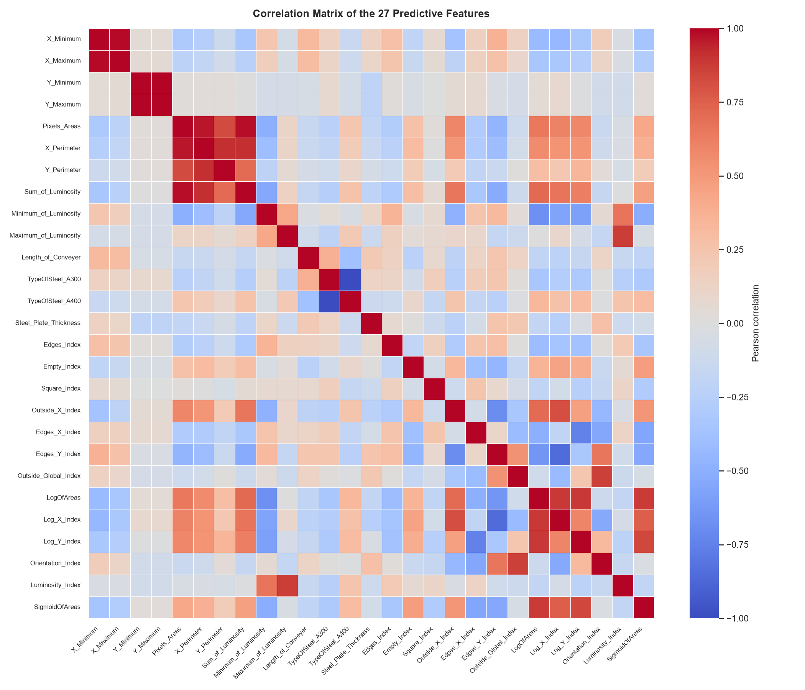
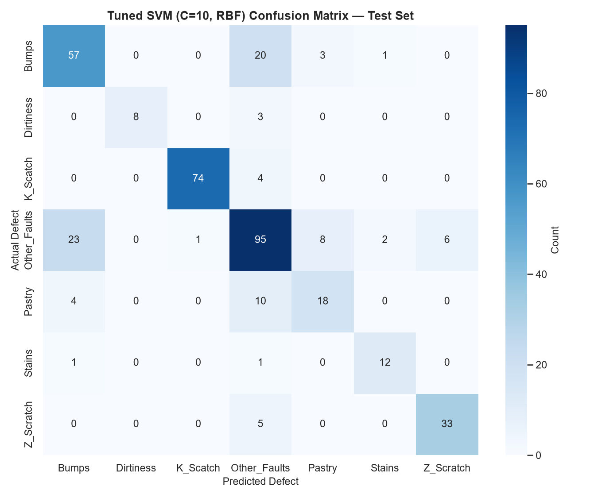
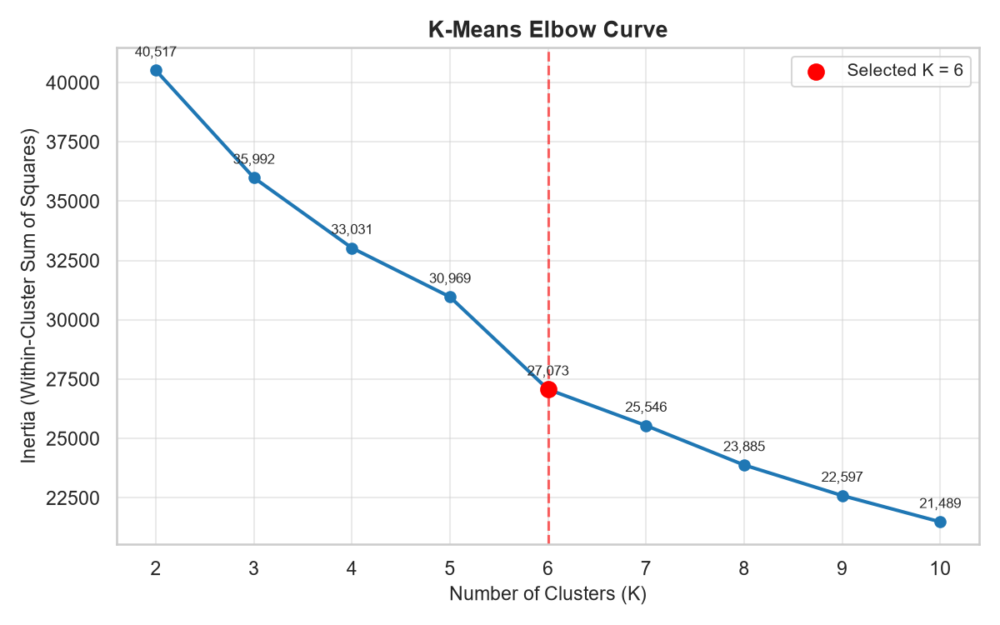
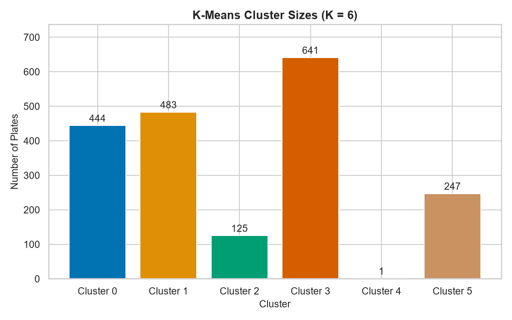
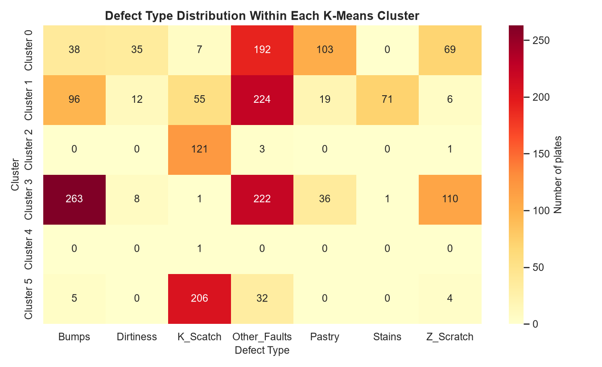
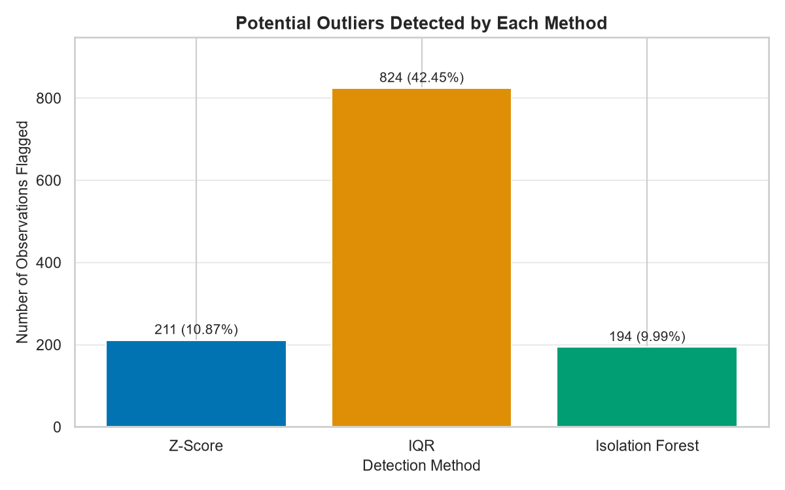
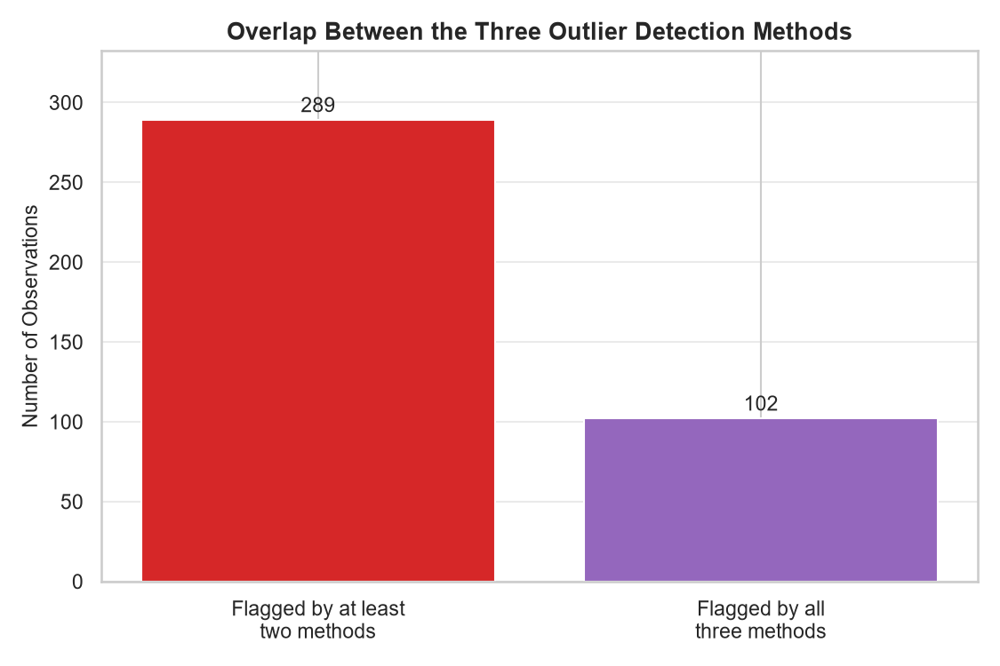
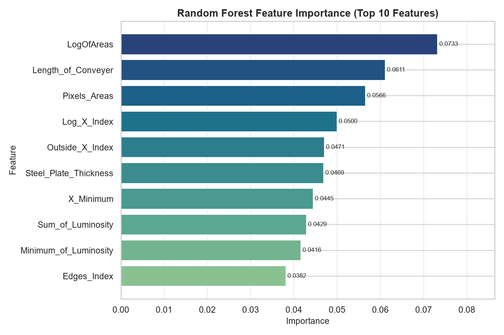
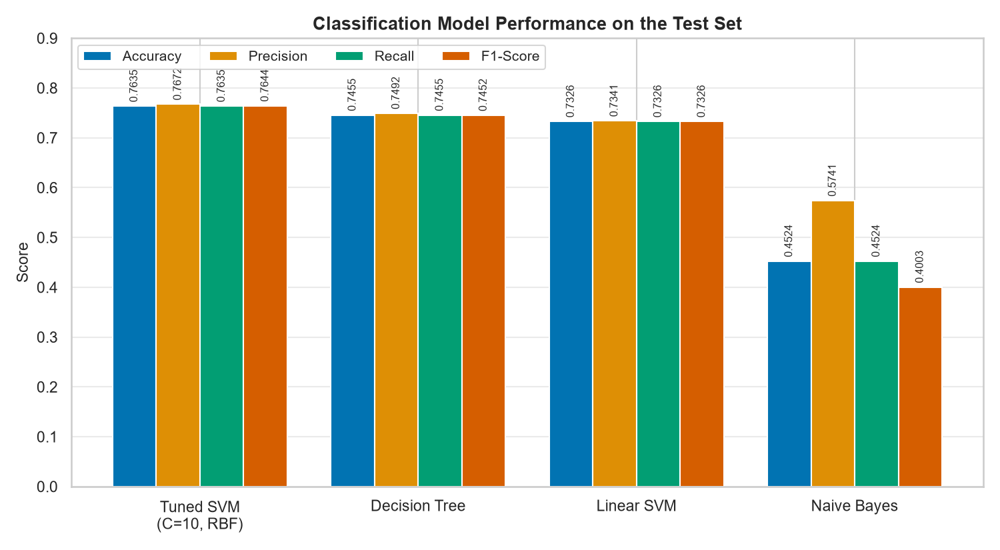

# Data Mining Laboratory Report: Steel Plate Quality Control Using Data Mining and Machine Learning

**Course:** Data Mining Laboratory  
**Project Title:** Steel Plate Quality Control Using Data Mining and Machine Learning  
**Dataset:** Steel Plate Faults (`Faults.NNA` & `Faults27x7_var` — 1,941 observations, 27 predictive features, 7 defect classes)  
**Source Notebook:** [`notebooks/steel_plate_quality_control.ipynb`](../notebooks/steel_plate_quality_control.ipynb)

---

## Project Overview

This laboratory report documents an end-to-end **data mining and machine learning workflow** applied to a steel-plate surface quality-control dataset. The primary objective is to **predict the surface defect type of a steel plate** from 27 numeric manufacturing, geometric, luminosity, and steel-type measurements, supplemented by unsupervised clustering, multi-method outlier detection, ensemble-based feature importance analysis, and a reusable prediction pipeline.

Each steel plate observation belongs to exactly one of seven mutually exclusive defect categories:

| Defect Class | Description in Project Context | Number of Plates | Percentage |
|---|---|---:|---:|
| `Other_Faults` | Remaining miscellaneous fault category | 673 | 34.67% |
| `Bumps` | Surface bumps defect class | 402 | 20.71% |
| `K_Scatch` | K-type surface scratch defect class | 391 | 20.14% |
| `Z_Scratch` | Z-type surface scratch defect class | 190 | 9.79% |
| `Pastry` | Pastry-like surface imperfection class | 158 | 8.14% |
| `Stains` | Surface staining defect class | 72 | 3.71% |
| `Dirtiness` | Surface dirt contamination class | 55 | 2.83% |
| **Total** | **All observations (single-label multiclass)** | **1,941** | **100.00%** |

---

## Table of Contents

- [Lab 1: Introduction to Python for Data Mining](#lab-1-introduction-to-python-for-data-mining)
  - [Lab Task 1.1: Importing Core Data Mining and Visualization Libraries](#lab-task-11-importing-core-data-mining-and-visualization-libraries)
  - [Lab Task 1.2: Importing the Raw Steel Plate Dataset and Column Definitions Using Pandas](#lab-task-12-importing-the-raw-steel-plate-dataset-and-column-definitions-using-pandas)
- [Lab 2: Data Preprocessing and Exploration](#lab-2-data-preprocessing-and-exploration)
  - [Lab Task 2.1: Initial Dataset Inspection — Shape, Sample Records, and Schema](#lab-task-21-initial-dataset-inspection--shape-sample-records-and-schema)
  - [Lab Task 2.2: Checking for Missing Values and Duplicate Records](#lab-task-22-checking-for-missing-values-and-duplicate-records)
  - [Lab Task 2.3: Inspecting Feature Data Types and Encoding Structure](#lab-task-23-inspecting-feature-data-types-and-encoding-structure)
  - [Lab Task 2.4: Computing Descriptive Statistics of Numeric Features](#lab-task-24-computing-descriptive-statistics-of-numeric-features)
  - [Lab Task 2.5: Verifying Class Distribution and Constructing the Single Target Variable (`Defect_Type`)](#lab-task-25-verifying-class-distribution-and-constructing-the-single-target-variable-defect_type)
  - [Lab Task 2.6: Separating Predictive Features (`X`) and Target (`y`) and Checking Feature Scales](#lab-task-26-separating-predictive-features-x-and-target-y-and-checking-feature-scales)
  - [Lab Task 2.7: Feature Scaling — Z-Score Standardization (`StandardScaler`)](#lab-task-27-feature-scaling--z-score-standardization-standardscaler)
- [Lab 3: Data Visualization and Exploratory Data Analysis (EDA)](#lab-3-data-visualization-and-exploratory-data-analysis-eda)
  - [Lab Task 3.1: Visualizing Target Defect Class Distribution (Bar Chart)](#lab-task-31-visualizing-target-defect-class-distribution-bar-chart)
  - [Lab Task 3.2: Analyzing Feature Distributions and Skewness Using Histograms](#lab-task-32-analyzing-feature-distributions-and-skewness-using-histograms)
  - [Lab Task 3.3: Exploring Defect Distribution Across Steel Types (`A300` vs. `A400`)](#lab-task-33-exploring-defect-distribution-across-steel-types-a300-vs-a400)
  - [Lab Task 3.4: Bivariate Relationship Analysis Using a Scatter Plot](#lab-task-34-bivariate-relationship-analysis-using-a-scatter-plot)
  - [Lab Task 3.5: Comparing Feature Spread and Class-Level Outliers Using Box Plots](#lab-task-35-comparing-feature-spread-and-class-level-outliers-using-box-plots)
  - [Lab Task 3.6: Computing the Correlation Matrix and Visualizing the Correlation Heatmap](#lab-task-36-computing-the-correlation-matrix-and-visualizing-the-correlation-heatmap)
  - [Lab Task 3.7: Exploratory Feature-Level Outlier Counting and Strongest Feature Correlations](#lab-task-37-exploratory-feature-level-outlier-counting-and-strongest-feature-correlations)
- [Lab 4: Classification – Decision Trees](#lab-4-classification--decision-trees)
  - [Lab Task 4.1: Stratified Train–Test Split and Class Balance Verification](#lab-task-41-stratified-traintest-split-and-class-balance-verification)
  - [Lab Task 4.2: Training the Decision Tree Classifier and Generating Predictions](#lab-task-42-training-the-decision-tree-classifier-and-generating-predictions)
  - [Lab Task 4.3: Evaluating the Decision Tree (Accuracy, Classification Report, and Confusion Matrix)](#lab-task-43-evaluating-the-decision-tree-accuracy-classification-report-and-confusion-matrix)
  - [Lab Task 4.4: Visualizing the Learned Decision Tree Structure](#lab-task-44-visualizing-the-learned-decision-tree-structure)
- [Lab 5: Classification – Naive Bayes](#lab-5-classification--naive-bayes)
  - [Lab Task 5.1: Training the Gaussian Naive Bayes Classifier and Generating Predictions](#lab-task-51-training-the-gaussian-naive-bayes-classifier-and-generating-predictions)
  - [Lab Task 5.2: Evaluating Gaussian Naive Bayes (Accuracy, Classification Report, and Confusion Matrix)](#lab-task-52-evaluating-gaussian-naive-bayes-accuracy-classification-report-and-confusion-matrix)
- [Lab 6: Classification – Support Vector Machines (SVM)](#lab-6-classification--support-vector-machines-svm)
  - [Lab Task 6.1: Leak-Free Standardization of Training and Testing Features (`svm_scaler`)](#lab-task-61-leak-free-standardization-of-training-and-testing-features-svm_scaler)
  - [Lab Task 6.2: Training and Evaluating the Baseline Linear SVM Classifier](#lab-task-62-training-and-evaluating-the-baseline-linear-svm-classifier)
  - [Lab Task 6.3: Baseline Classification Model Comparison (Overall and Per-Class F1 Analysis)](#lab-task-63-baseline-classification-model-comparison-overall-and-per-class-f1-analysis)
  - [Lab Task 6.4: SVM Hyperparameter Tuning Using 5-Fold Cross-Validated Grid Search (`GridSearchCV`)](#lab-task-64-svm-hyperparameter-tuning-using-5-fold-cross-validated-grid-search-gridsearchcv)
  - [Lab Task 6.5: Evaluating the Tuned RBF SVM (`C=10, kernel='rbf'`) on the Test Set](#lab-task-65-evaluating-the-tuned-rbf-svm-c10-kernelrbf-on-the-test-set)
- [Lab 7: Clustering – K-Means](#lab-7-clustering--k-means)
  - [Lab Task 7.1: Preparing and Standardizing Data for Unsupervised Clustering (`cluster_scaler`)](#lab-task-71-preparing-and-standardizing-data-for-unsupervised-clustering-cluster_scaler)
  - [Lab Task 7.2: Exploratory K-Means Clustering with `K = 2`](#lab-task-72-exploratory-k-means-clustering-with-k--2)
  - [Lab Task 7.3: Selecting the Optimal Number of Clusters Using the Elbow Method (`K = 2` to `10`)](#lab-task-73-selecting-the-optimal-number-of-clusters-using-the-elbow-method-k--2-to-10)
  - [Lab Task 7.4: Training the Final K-Means Model (`K = 6`) and Examining Cluster Sizes](#lab-task-74-training-the-final-k-means-model-k--6-and-examining-cluster-sizes)
  - [Lab Task 7.5: Visualizing Clusters and Centroids in 2D Using Principal Component Analysis (PCA)](#lab-task-75-visualizing-clusters-and-centroids-in-2d-using-principal-component-analysis-pca)
  - [Lab Task 7.6: Post-Hoc Cluster Interpretation Against True Defect Classes and Singleton Analysis](#lab-task-76-post-hoc-cluster-interpretation-against-true-defect-classes-and-singleton-analysis)
- [Lab 8: Outlier Detection and Ensemble Methods](#lab-8-outlier-detection-and-ensemble-methods)
  - [Lab Task 8.1: Statistical Outlier Detection Using the Z-Score Method (`|Z| > 3`)](#lab-task-81-statistical-outlier-detection-using-the-z-score-method-z--3)
  - [Lab Task 8.2: Quartile-Based Outlier Detection Using the Interquartile Range (IQR) Method](#lab-task-82-quartile-based-outlier-detection-using-the-interquartile-range-iqr-method)
  - [Lab Task 8.3: Model-Based Anomaly Detection Using Isolation Forest (`contamination = 0.10`)](#lab-task-83-model-based-anomaly-detection-using-isolation-forest-contamination--010)
  - [Lab Task 8.4: Multi-Method Outlier Comparison and Consensus Outlier Identification](#lab-task-84-multi-method-outlier-comparison-and-consensus-outlier-identification)
  - [Lab Task 8.5: Investigating Three-Method Consensus Outliers and the Most Extreme Plate (Row 391)](#lab-task-85-investigating-three-method-consensus-outliers-and-the-most-extreme-plate-row-391)
  - [Lab Task 8.6: Ensemble Methods — Training a Random Forest Classifier for Feature Importance](#lab-task-86-ensemble-methods--training-a-random-forest-classifier-for-feature-importance)
  - [Lab Task 8.7: Top/Bottom Feature Importance Analysis and Visualization](#lab-task-87-topbottom-feature-importance-analysis-and-visualization)
- [Lab 9: Mini Project – End-to-End Data Mining Pipeline](#lab-9-mini-project--end-to-end-data-mining-pipeline)
  - [Lab Task 9.1: Final Classification Model Comparison and Selection](#lab-task-91-final-classification-model-comparison-and-selection)
  - [Lab Task 9.2: Saving and Verifying Model Artifacts (`tuned_svm_model.pkl`, Scaler, and `feature_names.pkl`)](#lab-task-92-saving-and-verifying-model-artifacts-tuned_svm_modelpkl-scaler-and-feature_namespkl)
  - [Lab Task 9.3: End-to-End Reusable Prediction Pipeline, Limitations, and Conclusion](#lab-task-93-end-to-end-reusable-prediction-pipeline-limitations-and-conclusion)

---

# Lab 1: Introduction to Python for Data Mining

## Lab Task 1.1: Importing Core Data Mining and Visualization Libraries

### Explanation
Setting up the computational environment at the start of the notebook ensures reproducibility across all subsequent analytical steps.
- `pandas` handles tabular data ingestion, DataFrame manipulation, cross-tabulations, and summary tables.
- `numpy` supports vectorized numerical computation, array masking, and aggregations.
- `matplotlib.pyplot` and `seaborn` provide foundational and statistical plotting capabilities for exploratory analysis and model evaluation.

### Code
```python
import pandas as pd
import numpy as np
import matplotlib.pyplot as plt
import seaborn as sns
```

### Output
*(Libraries imported into the session with no console output.)*

---

## Lab Task 1.2: Importing the Raw Steel Plate Dataset and Column Definitions Using Pandas

### Explanation
The steel-plate fault dataset is distributed across two files:
1. `Faults.NNA` — a tab-separated numeric data file without a header row.
2. `Faults27x7_var` — a plain-text file listing the 34 variable names (one per line), representing **27 predictive features** and **7 binary defect indicator columns**.

The variable names are read first into a Python list and passed to `pd.read_csv(..., sep="\t", header=None, names=columns)` so that each numeric column is properly labeled upon import.

### Code
```python
# Load the datasets
data_path = "../data/Faults.NNA"
columns_path = "../data/Faults27x7_var"

# Read column names
with open(columns_path, "r") as f:
    columns = [line.strip() for line in f]

# Read the dataset
df = pd.read_csv(
    data_path,
    sep="\t",
    header=None,
    names=columns
)

print("Dataset loaded successfully!")
```

### Output
```text
Dataset loaded successfully!
```

### Interpretation
The raw dataset and its 34 column headers are combined into a single `pandas` DataFrame `df` containing 1,941 steel-plate records.

---

# Lab 2: Data Preprocessing and Exploration

## Lab Task 2.1: Initial Dataset Inspection — Shape, Sample Records, and Schema

### Explanation
Before applying transformations or training models, an initial structural inspection verifies the dataset's row/column dimensions (`df.shape`), previews actual values (`df.head()`), lists all variable names (`df.columns`), and checks non-null counts and data types (`df.info()`).

### Code
```python
print("Dataset Shape:", df.shape)

print("\nFirst 5 Rows:")
display(df.head())

print("\nColumn Names:")
print(df.columns.tolist())

print("\nDataset Information:")
df.info()
```

### Output
```text
Dataset Shape: (1941, 34)

First 5 Rows:
   X_Minimum  X_Maximum  Y_Minimum  Y_Maximum  Pixels_Areas  X_Perimeter  \
0         42         50     270900     270944           267           17   
1        645        651    2538079    2538108           108           10   
2        829        835    1553913    1553931            71            8   
3        853        860     369370     369415           176           13   
4       1289       1306     498078     498335          2409           60   

   Y_Perimeter  Sum_of_Luminosity  Minimum_of_Luminosity  \
0           44              24220                     76   
1           30              11397                     84   
2           19               7972                     99   
3           45              18996                     99   
4          260             246930                     37   

   Maximum_of_Luminosity  ...  Orientation_Index  Luminosity_Index  \
0                    108  ...             0.8182           -0.2913   
1                    123  ...             0.7931           -0.1756   
2                    125  ...             0.6667           -0.1228   
3                    126  ...             0.8444           -0.1568   
4                    126  ...             0.9338           -0.1992   

   SigmoidOfAreas  Pastry  Z_Scratch  K_Scatch  Stains  Dirtiness  Bumps  \
0          0.5822       1          0         0       0          0      0   
1          0.2984       1          0         0       0          0      0   
2          0.2150       1          0         0       0          0      0   
3          0.5212       1          0         0       0          0      0   
4          1.0000       1          0         0       0          0      0   

   Other_Faults  
0             0  
1             0  
2             0  
3             0  
4             0  

[5 rows x 34 columns]

Column Names:
['X_Minimum', 'X_Maximum', 'Y_Minimum', 'Y_Maximum', 'Pixels_Areas', 'X_Perimeter', 'Y_Perimeter', 'Sum_of_Luminosity', 'Minimum_of_Luminosity', 'Maximum_of_Luminosity', 'Length_of_Conveyer', 'TypeOfSteel_A300', 'TypeOfSteel_A400', 'Steel_Plate_Thickness', 'Edges_Index', 'Empty_Index', 'Square_Index', 'Outside_X_Index', 'Edges_X_Index', 'Edges_Y_Index', 'Outside_Global_Index', 'LogOfAreas', 'Log_X_Index', 'Log_Y_Index', 'Orientation_Index', 'Luminosity_Index', 'SigmoidOfAreas', 'Pastry', 'Z_Scratch', 'K_Scatch', 'Stains', 'Dirtiness', 'Bumps', 'Other_Faults']

Dataset Information:
<class 'pandas.DataFrame'>
RangeIndex: 1941 entries, 0 to 1940
Data columns (total 34 columns):
 #   Column                 Non-Null Count  Dtype  
---  ------                 --------------  -----  
 0   X_Minimum              1941 non-null   int64  
 1   X_Maximum              1941 non-null   int64  
 2   Y_Minimum              1941 non-null   int64  
 3   Y_Maximum              1941 non-null   int64  
 4   Pixels_Areas           1941 non-null   int64  
 5   X_Perimeter            1941 non-null   int64  
 6   Y_Perimeter            1941 non-null   int64  
 7   Sum_of_Luminosity      1941 non-null   int64  
 8   Minimum_of_Luminosity  1941 non-null   int64  
 9   Maximum_of_Luminosity  1941 non-null   int64  
 10  Length_of_Conveyer     1941 non-null   int64  
 11  TypeOfSteel_A300       1941 non-null   int64  
 12  TypeOfSteel_A400       1941 non-null   int64  
 13  Steel_Plate_Thickness  1941 non-null   int64  
 14  Edges_Index            1941 non-null   float64
 15  Empty_Index            1941 non-null   float64
 16  Square_Index           1941 non-null   float64
 17  Outside_X_Index        1941 non-null   float64
 18  Edges_X_Index          1941 non-null   float64
 19  Edges_Y_Index          1941 non-null   float64
 20  Outside_Global_Index   1941 non-null   float64
 21  LogOfAreas             1941 non-null   float64
 22  Log_X_Index            1941 non-null   float64
 23  Log_Y_Index            1941 non-null   float64
 24  Orientation_Index      1941 non-null   float64
 25  Luminosity_Index       1941 non-null   float64
 26  SigmoidOfAreas         1941 non-null   float64
 27  Pastry                 1941 non-null   int64  
 28  Z_Scratch              1941 non-null   int64  
 29  K_Scatch               1941 non-null   int64  
 30  Stains                 1941 non-null   int64  
 31  Dirtiness              1941 non-null   int64  
 32  Bumps                  1941 non-null   int64  
 33  Other_Faults           1941 non-null   int64  
dtypes: float64(13), int64(21)
memory usage: 515.7 KB
```

### Interpretation
- The dataset contains **1,941 rows and 34 columns** (`21` integer columns and `13` floating-point columns).
- Every column has `1,941 non-null` entries.
- The preview reveals large differences in scale across columns (e.g., `Y_Minimum` is in the hundreds of thousands or millions, whereas index features such as `Luminosity_Index` and `SigmoidOfAreas` lie between `-1` and `1`).

---

## Lab Task 2.2: Checking for Missing Values and Duplicate Records

### Explanation
Missing values can distort statistical summaries and cause machine-learning estimators to fail, while duplicate rows artificially overweight repeated observations and can leak identical records across train and test splits. Both are checked explicitly before preprocessing.

### Code
```python
print("Missing Values:")
print(df.isnull().sum())

print("\nDuplicate Rows:", df.duplicated().sum())
```

### Output
```text
Missing Values:
X_Minimum                0
X_Maximum                0
Y_Minimum                0
Y_Maximum                0
Pixels_Areas             0
X_Perimeter              0
Y_Perimeter              0
Sum_of_Luminosity        0
Minimum_of_Luminosity    0
Maximum_of_Luminosity    0
Length_of_Conveyer       0
TypeOfSteel_A300         0
TypeOfSteel_A400         0
Steel_Plate_Thickness    0
Edges_Index              0
Empty_Index              0
Square_Index             0
Outside_X_Index          0
Edges_X_Index            0
Edges_Y_Index            0
Outside_Global_Index     0
LogOfAreas               0
Log_X_Index              0
Log_Y_Index              0
Orientation_Index        0
Luminosity_Index         0
SigmoidOfAreas           0
Pastry                   0
Z_Scratch                0
K_Scatch                 0
Stains                   0
Dirtiness                0
Bumps                    0
Other_Faults             0
dtype: int64

Duplicate Rows: 0
```

### Interpretation
The dataset has **0 missing values** across all 34 columns and **0 duplicate rows**. Consequently, no missing-value imputation or deduplication is required.

---

## Lab Task 2.3: Inspecting Feature Data Types and Encoding Structure

### Explanation
Machine-learning algorithms in `scikit-learn` require numeric feature matrices. Inspecting `df.dtypes` confirms whether any categorical string variables exist that would require label or one-hot encoding.

### Code
```python
print("\nData Types:")
print(df.dtypes)
```

### Output
```text
Data Types:
X_Minimum                  int64
X_Maximum                  int64
Y_Minimum                  int64
Y_Maximum                  int64
Pixels_Areas               int64
X_Perimeter                int64
Y_Perimeter                int64
Sum_of_Luminosity          int64
Minimum_of_Luminosity      int64
Maximum_of_Luminosity      int64
Length_of_Conveyer         int64
TypeOfSteel_A300           int64
TypeOfSteel_A400           int64
Steel_Plate_Thickness      int64
Edges_Index              float64
Empty_Index              float64
Square_Index             float64
Outside_X_Index          float64
Edges_X_Index            float64
Edges_Y_Index            float64
Outside_Global_Index     float64
LogOfAreas               float64
Log_X_Index              float64
Log_Y_Index              float64
Orientation_Index        float64
Luminosity_Index         float64
SigmoidOfAreas           float64
Pastry                     int64
Z_Scratch                  int64
K_Scatch                   int64
Stains                     int64
Dirtiness                  int64
Bumps                      int64
Other_Faults               int64
dtype: object
```

### Interpretation
All 34 columns are already numeric (`int64` and `float64`). Categorical steel grade is already binary-encoded in the dataset via `TypeOfSteel_A300` and `TypeOfSteel_A400` (`0`/`1`), so no additional categorical feature encoding is needed.

---

## Lab Task 2.4: Computing Descriptive Statistics of Numeric Features

### Explanation
`df.describe()` computes the count, mean, standard deviation, minimum, quartiles (`25%`, `50%`, `75%`), and maximum for each column, providing a quantitative overview of central tendency, spread, skewness, and extreme values.

### Code
```python
print("\nDescriptive Statistics:")
display(df.describe())
```

### Output
| Feature | Count | Mean | Std | Min | 25% | 50% | 75% | Max |
|---|---:|---:|---:|---:|---:|---:|---:|---:|
| `X_Minimum` | 1941 | 571.1360 | 520.6907 | 0 | 51 | 435 | 1053 | 1705 |
| `X_Maximum` | 1941 | 617.9645 | 497.6274 | 4 | 192 | 467 | 1072 | 1713 |
| `Y_Minimum` | 1941 | 1.6507e+06 | 1.7746e+06 | 6712 | 4.7125e+05 | 1.2041e+06 | 2.1831e+06 | 1.2988e+07 |
| `Y_Maximum` | 1941 | 1.6507e+06 | 1.7746e+06 | 6724 | 4.7128e+05 | 1.2041e+06 | 2.1831e+06 | 1.2988e+07 |
| `Pixels_Areas` | 1941 | 1893.8784 | 5168.4596 | 2 | 84 | 174 | 822 | 152655 |
| `X_Perimeter` | 1941 | 111.8552 | 301.2092 | 2 | 15 | 26 | 84 | 10449 |
| `Y_Perimeter` | 1941 | 82.9660 | 426.4829 | 1 | 13 | 25 | 83 | 18152 |
| `Sum_of_Luminosity` | 1941 | 2.0631e+05 | 5.1229e+05 | 250 | 9522 | 19202 | 83011 | 1.1591e+07 |
| `Minimum_of_Luminosity` | 1941 | 84.5487 | 32.1343 | 0 | 63 | 90 | 106 | 203 |
| `Maximum_of_Luminosity` | 1941 | 130.1937 | 18.6910 | 37 | 124 | 127 | 140 | 253 |
| `Length_of_Conveyer` | 1941 | 1459.1602 | 144.5778 | 1227 | 1358 | 1364 | 1650 | 1794 |
| `TypeOfSteel_A300` | 1941 | 0.4003 | 0.4901 | 0 | 0 | 0 | 1 | 1 |
| `TypeOfSteel_A400` | 1941 | 0.5997 | 0.4901 | 0 | 0 | 1 | 1 | 1 |
| `Steel_Plate_Thickness` | 1941 | 78.7378 | 55.0860 | 40 | 40 | 70 | 80 | 300 |
| `Edges_Index` | 1941 | 0.3317 | 0.2997 | 0 | 0.0604 | 0.2273 | 0.5738 | 0.9952 |
| `Empty_Index` | 1941 | 0.4142 | 0.1373 | 0 | 0.3158 | 0.4121 | 0.5016 | 0.9439 |
| `Square_Index` | 1941 | 0.5708 | 0.2711 | 0.0083 | 0.3613 | 0.5556 | 0.8182 | 1.0000 |
| `Outside_X_Index` | 1941 | 0.0334 | 0.0590 | 0.0015 | 0.0066 | 0.0101 | 0.0235 | 0.8759 |
| `Edges_X_Index` | 1941 | 0.6105 | 0.2433 | 0.0144 | 0.4118 | 0.6364 | 0.8000 | 1.0000 |
| `Edges_Y_Index` | 1941 | 0.8135 | 0.2343 | 0.0484 | 0.5968 | 0.9474 | 1.0000 | 1.0000 |
| `Outside_Global_Index` | 1941 | 0.5757 | 0.4824 | 0 | 0 | 1.0000 | 1.0000 | 1.0000 |
| `LogOfAreas` | 1941 | 2.4924 | 0.7889 | 0.3010 | 1.9243 | 2.2406 | 2.9149 | 5.1837 |
| `Log_X_Index` | 1941 | 1.3357 | 0.4816 | 0.3010 | 1.0000 | 1.1761 | 1.5185 | 3.0741 |
| `Log_Y_Index` | 1941 | 1.4033 | 0.4543 | 0 | 1.0792 | 1.3222 | 1.7324 | 4.2587 |
| `Orientation_Index` | 1941 | 0.0833 | 0.5009 | -0.9910 | -0.3333 | 0.0952 | 0.5116 | 0.9917 |
| `Luminosity_Index` | 1941 | -0.1313 | 0.1488 | -0.9989 | -0.1950 | -0.1330 | -0.0666 | 0.6421 |
| `SigmoidOfAreas` | 1941 | 0.5854 | 0.3395 | 0.1190 | 0.2482 | 0.5063 | 0.9998 | 1.0000 |

### Interpretation
1. **Extreme scale disparity:** Coordinate and luminosity totals (`Y_Minimum`, `Y_Maximum`, `Sum_of_Luminosity`) reach `10^7`, whereas dimensionless geometric/luminosity indexes lie within `[-1, 1]`.
2. **Right-skewness and extreme maxima:** For features such as `Pixels_Areas` (median `174`, 75th percentile `822`, maximum `152,655`) and `Y_Perimeter` (median `25`, maximum `18,152`), the maximum is orders of magnitude above the third quartile, signaling strong right skewness and extreme observations.

---

## Lab Task 2.5: Verifying Class Distribution and Constructing the Single Target Variable (`Defect_Type`)

### Explanation
The raw dataset encodes the target across seven binary (`0`/`1`) indicator columns. Before collapsing them into a single multiclass target column (`Defect_Type`) via `idxmax(axis=1)`, we verify that every row has **exactly one** active defect indicator (`sum(axis=1) == 1`). After creating `Defect_Type`, the seven indicator columns are dropped so target information cannot leak into the predictors.

### Code
```python
fault_columns = [
    "Pastry",
    "Z_Scratch",
    "K_Scatch",
    "Stains",
    "Dirtiness",
    "Bumps",
    "Other_Faults"
]

fault_counts = df[fault_columns].sum()
print("Number of plates in each defect class:")
display(fault_counts)

# Verify defect labels per row
labels_per_row = df[fault_columns].sum(axis=1)
print("Minimum labels per row:", labels_per_row.min())
print("Maximum labels per row:", labels_per_row.max())
print("\nRows with exactly one defect label:", (labels_per_row == 1).sum())
print("Total rows:", len(df))

# Construct single target variable and drop binary indicator columns
df["Defect_Type"] = df[fault_columns].idxmax(axis=1)
df = df.drop(columns=fault_columns)

print("\nNew Dataset Shape:", df.shape)
print("\nDefect Type Distribution:")
display(df["Defect_Type"].value_counts())
```

### Output
```text
Number of plates in each defect class:
Pastry          158
Z_Scratch       190
K_Scatch        391
Stains           72
Dirtiness        55
Bumps           402
Other_Faults    673
dtype: int64

Minimum labels per row: 1
Maximum labels per row: 1

Rows with exactly one defect label: 1941
Total rows: 1941

New Dataset Shape: (1941, 28)

Defect Type Distribution:
Defect_Type
Other_Faults    673
Bumps           402
K_Scatch        391
Z_Scratch       190
Pastry          158
Stains           72
Dirtiness        55
Name: count, dtype: int64
```

### Interpretation
- Every one of the `1,941` observations has **exactly one** defect label (`min = 1`, `max = 1`), confirming this is a **single-label multiclass classification** problem.
- The classes are noticeably **imbalanced**: `Other_Faults` (`673` plates) is more than 12 times larger than `Dirtiness` (`55` plates). Consequently, model evaluation must report **weighted Precision, Recall, and F1-score** alongside Accuracy.
- Dropping the seven indicator columns reduces `df` from `(1941, 34)` to `(1941, 28)` (`27` features + `Defect_Type`).

---

## Lab Task 2.6: Separating Predictive Features (`X`) and Target (`y`) and Checking Feature Scales

### Explanation
The DataFrame is split into the feature matrix `X` (27 predictive variables) and target vector `y` (`Defect_Type`). A summary table of minimum, maximum, mean, and standard deviation across `X` is then inspected to quantify scale differences before standardization.

### Code
```python
X = df.drop(columns=["Defect_Type"])
y = df["Defect_Type"]

print("Features shape:", X.shape)
print("Target shape:", y.shape)

feature_summary = pd.DataFrame({
    "Minimum": X.min(),
    "Maximum": X.max(),
    "Mean": X.mean(),
    "Standard Deviation": X.std()
})

display(feature_summary)
```

### Output
```text
Features shape: (1941, 27)
Target shape: (1941,)
```

| Feature | Minimum | Maximum | Mean | Standard Deviation |
|---|---:|---:|---:|---:|
| `X_Minimum` | 0.0000 | 1.7050e+03 | 5.7114e+02 | 5.2069e+02 |
| `X_Maximum` | 4.0000 | 1.7130e+03 | 6.1796e+02 | 4.9763e+02 |
| `Y_Minimum` | 6712.0000 | 1.2988e+07 | 1.6507e+06 | 1.7746e+06 |
| `Y_Maximum` | 6724.0000 | 1.2988e+07 | 1.6507e+06 | 1.7746e+06 |
| `Pixels_Areas` | 2.0000 | 1.5266e+05 | 1.8939e+03 | 5.1685e+03 |
| `X_Perimeter` | 2.0000 | 1.0449e+04 | 1.1186e+02 | 3.0121e+02 |
| `Y_Perimeter` | 1.0000 | 1.8152e+04 | 8.2966e+01 | 4.2648e+02 |
| `Sum_of_Luminosity` | 250.0000 | 1.1591e+07 | 2.0631e+05 | 5.1229e+05 |
| `Minimum_of_Luminosity` | 0.0000 | 2.0300e+02 | 8.4549e+01 | 3.2134e+01 |
| `Maximum_of_Luminosity` | 37.0000 | 2.5300e+02 | 1.3019e+02 | 1.8691e+01 |
| `Length_of_Conveyer` | 1227.0000 | 1.7940e+03 | 1.4592e+03 | 1.4458e+02 |
| `TypeOfSteel_A300` | 0.0000 | 1.0000 | 4.0031e-01 | 4.9009e-01 |
| `TypeOfSteel_A400` | 0.0000 | 1.0000 | 5.9969e-01 | 4.9009e-01 |
| `Steel_Plate_Thickness` | 40.0000 | 3.0000e+02 | 7.8738e+01 | 5.5086e+01 |
| `Edges_Index` | 0.0000 | 9.9520e-01 | 3.3172e-01 | 2.9971e-01 |
| `Empty_Index` | 0.0000 | 9.4390e-01 | 4.1420e-01 | 1.3726e-01 |
| `Square_Index` | 0.0083 | 1.0000 | 5.7077e-01 | 2.7106e-01 |
| `Outside_X_Index` | 0.0015 | 8.7590e-01 | 3.3361e-02 | 5.8961e-02 |
| `Edges_X_Index` | 0.0144 | 1.0000 | 6.1053e-01 | 2.4328e-01 |
| `Edges_Y_Index` | 0.0484 | 1.0000 | 8.1347e-01 | 2.3427e-01 |
| `Outside_Global_Index` | 0.0000 | 1.0000 | 5.7573e-01 | 4.8235e-01 |
| `LogOfAreas` | 0.3010 | 5.1837 | 2.4924 | 7.8893e-01 |
| `Log_X_Index` | 0.3010 | 3.0741 | 1.3357 | 4.8161e-01 |
| `Log_Y_Index` | 0.0000 | 4.2587 | 1.4033 | 4.5435e-01 |
| `Orientation_Index` | -0.9910 | 9.9170e-01 | 8.3288e-02 | 5.0087e-01 |
| `Luminosity_Index` | -0.9989 | 6.4210e-01 | -1.3131e-01 | 1.4877e-01 |
| `SigmoidOfAreas` | 0.1190 | 1.0000 | 5.8542e-01 | 3.3945e-01 |

### Interpretation
Because standard deviations range from `0.059` (`Outside_X_Index`) to `1.77 × 10^6` (`Y_Maximum`), distance- and margin-based algorithms such as Support Vector Machines and K-Means would be completely dominated by high-magnitude features unless standardized.

---

## Lab Task 2.7: Feature Scaling — Z-Score Standardization (`StandardScaler`)

### Explanation
`StandardScaler` transforms each feature $x$ into a standardized score:
$$z = \frac{x - \mu}{\sigma}$$
so that every transformed feature has a mean of `0.0` and a standard deviation of `1.0`. Here, `scaler` demonstrates standardization across the feature matrix `X` (while Section 6.1 fits a dedicated `svm_scaler` strictly on `X_train` to prevent test-set leakage during supervised learning).

### Code
```python
from sklearn.preprocessing import StandardScaler

scaler = StandardScaler()
X_scaled = scaler.fit_transform(X)

X_scaled = pd.DataFrame(
    X_scaled,
    columns=X.columns,
    index=X.index
)

display(X_scaled.head())

print("Mean after standardization:")
display(X_scaled.mean().round(2))

print("\nStandard deviation after standardization:")
display(X_scaled.std().round(2))
```

### Output
```text
   X_Minimum  X_Maximum  Y_Minimum  Y_Maximum  Pixels_Areas  X_Perimeter  \
0  -1.016481  -1.141639  -0.777729  -0.777729     -0.314852    -0.314996   
1   0.141894   0.066403   0.500188   0.500171     -0.345623    -0.338242   
2   0.495362   0.436253  -0.054546  -0.054566     -0.352784    -0.344883   
3   0.541467   0.486504  -0.722225  -0.722225     -0.332463    -0.328279   
4   1.379032   1.382988  -0.649678  -0.649559      0.099692    -0.172201   
...
[5 rows x 27 columns]

Mean after standardization:
All 27 features: 0.0

Standard deviation after standardization:
All 27 features: 1.0
```

### Interpretation
Every feature in `X_scaled` now has a verified mean of `0.0` and a standard deviation of `1.0`, placing all 27 measurements on a common dimensionless scale.

---

# Lab 3: Data Visualization and Exploratory Data Analysis (EDA)

## Lab Task 3.1: Visualizing Target Defect Class Distribution (Bar Chart)

### Explanation
A bar chart (`sns.countplot`) ordered by class frequency provides an immediate visual representation of class imbalance across the seven defect categories.

### Code
```python
plt.figure(figsize=(10, 6))

sns.countplot(
    data=df,
    x="Defect_Type",
    order=df["Defect_Type"].value_counts().index
)

plt.title("Distribution of Steel Plate Defect Types")
plt.xlabel("Defect Type")
plt.ylabel("Number of Plates")
plt.xticks(rotation=45)

plt.show()
```

### Output


### Interpretation
`Other_Faults` (`673`), `Bumps` (`402`), and `K_Scatch` (`391`) dominate the dataset (accounting for `75.5%` of all records), whereas `Stains` (`72`) and `Dirtiness` (`55`) are small minority classes. This visual evidence reinforces the use of stratified splitting (`stratify=y`) and weighted F1 evaluation.

---

## Lab Task 3.2: Analyzing Feature Distributions and Skewness Using Histograms

### Explanation
Histograms paired with Kernel Density Estimation (`kde=True`) illustrate the distributional shape, skewness, and tail behavior of representative geometric, physical, and luminosity features: `Pixels_Areas`, `Steel_Plate_Thickness`, `Edges_Index`, and `Luminosity_Index`.

### Code
```python
selected_features = [
    "Pixels_Areas",
    "Steel_Plate_Thickness",
    "Edges_Index",
    "Luminosity_Index"
]

for feature in selected_features:
    plt.figure(figsize=(8, 5))
    
    sns.histplot(
        data=df,
        x=feature,
        bins=30,
        kde=True
    )
    
    plt.title(f"Distribution of {feature}")
    plt.xlabel(feature)
    plt.ylabel("Frequency")
    
    plt.show()
```

### Output
*(Four 30-bin histograms with KDE curves rendered for `Pixels_Areas`, `Steel_Plate_Thickness`, `Edges_Index`, and `Luminosity_Index`.)*

### Interpretation
- `Pixels_Areas` is heavily right-skewed: most observations cluster near small pixel areas (`< 1,000`), with a long upper tail extending past `150,000`.
- `Steel_Plate_Thickness` is discrete-multimodal and right-skewed, concentrated between `40` and `100` with tail observations up to `300`.
- `Edges_Index` is moderately right-skewed across `[0, 1]`, while `Luminosity_Index` is more bell-shaped and centered near `-0.13` but exhibits mild skewness and tail values.

---

## Lab Task 3.3: Exploring Defect Distribution Across Steel Types (`A300` vs. `A400`)

### Explanation
Using `np.where`, the binary steel grade indicators (`TypeOfSteel_A300` and `TypeOfSteel_A400`) are mapped to categorical labels `"A300"` and `"A400"`, cross-tabulated against `Defect_Type`, and plotted as a grouped bar chart to check whether specific defects occur predominantly on one steel grade.

### Code
```python
steel_type = np.where(
    df["TypeOfSteel_A300"] == 1,
    "A300",
    "A400"
)

steel_type_defects = pd.crosstab(
    steel_type,
    df["Defect_Type"]
)

display(steel_type_defects)

# Visualize defect counts by steel type
steel_type_defects.plot(
    kind="bar",
    figsize=(10, 6)
)

plt.title("Defect Distribution by Steel Type")
plt.xlabel("Steel Type")
plt.ylabel("Number of Plates")
plt.xticks(rotation=0)
plt.legend(title="Defect Type")

plt.show()
```

### Output
| Steel Type | `Bumps` | `Dirtiness` | `K_Scatch` | `Other_Faults` | `Pastry` | `Stains` | `Z_Scratch` |
|---|---:|---:|---:|---:|---:|---:|---:|
| **A300** | 279 | 9 | 1 | 266 | 49 | 1 | 172 |
| **A400** | 123 | 46 | 390 | 407 | 109 | 71 | 18 |

*(Grouped bar chart of Defect Distribution by Steel Type rendered.)*

### Interpretation
There is a strong empirical association between steel grade and defect class in this dataset:
- Almost all `K_Scatch` (`390` of `391`, `99.7%`) and `Stains` (`71` of `72`, `98.6%`), as well as most `Dirtiness` (`46` of `55`, `83.6%`), occur on **A400** steel plates.
- Conversely, `Z_Scratch` (`172` of `190`, `90.5%`) and the majority of `Bumps` (`279` of `402`, `69.4%`) occur on **A300** steel plates.

---

## Lab Task 3.4: Bivariate Relationship Analysis Using a Scatter Plot

### Explanation
A scatter plot of `Pixels_Areas` versus `Sum_of_Luminosity` colored by `Defect_Type` inspects how defect area and total reflected light co-vary across classes and reveals any extreme bivariate points.

### Code
```python
plt.figure(figsize=(10, 6))

sns.scatterplot(
    data=df,
    x="Pixels_Areas",
    y="Sum_of_Luminosity",
    hue="Defect_Type",
    alpha=0.7
)

plt.title("Pixels Area vs Sum of Luminosity by Defect Type")
plt.xlabel("Pixels Areas")
plt.ylabel("Sum of Luminosity")
plt.legend(title="Defect Type", bbox_to_anchor=(1.05, 1), loc="upper left")

plt.show()
```

### Output
*(Scatter plot of `Pixels_Areas` vs. `Sum_of_Luminosity` colored by `Defect_Type` rendered.)*

### Interpretation
`Pixels_Areas` and `Sum_of_Luminosity` exhibit an almost linear positive relationship ($r = 0.9790$) because larger defect regions naturally sum over more pixel luminosities. Most classes overlap near the origin, while `K_Scatch` observations extend far along the upper-right tail, including one extreme point at `Pixels_Areas = 152,655`.

---

## Lab Task 3.5: Comparing Feature Spread and Class-Level Outliers Using Box Plots

### Explanation
Box plots grouped by `Defect_Type` display the median, interquartile range (`Q1` to `Q3`), whiskers, and points beyond $1.5 \times \text{IQR}$ for `Pixels_Areas`, `Steel_Plate_Thickness`, `Edges_Index`, and `Luminosity_Index`.

### Code
```python
selected_features = [
    "Pixels_Areas",
    "Steel_Plate_Thickness",
    "Edges_Index",
    "Luminosity_Index"
]

for feature in selected_features:
    plt.figure(figsize=(8, 5))
    
    sns.boxplot(
        data=df,
        x="Defect_Type",
        y=feature
    )
    
    plt.title(f"{feature} Distribution by Defect Type")
    plt.xlabel("Defect Type")
    plt.ylabel(feature)
    plt.xticks(rotation=45)
    
    plt.show()
```

### Output
*(Four class-conditioned box plots rendered for `Pixels_Areas`, `Steel_Plate_Thickness`, `Edges_Index`, and `Luminosity_Index`.)*

### Interpretation
- `K_Scatch` exhibits substantially higher median and upper-quartile `Pixels_Areas` than the other six classes, along with prominent high-value outliers.
- `Steel_Plate_Thickness` shows distinct class profiles (for instance, `Stains` and `K_Scatch` are concentrated at lower thicknesses near `40`, whereas `Pastry` and `Other_Faults` span thicker plates).
- Numerous points lie beyond the whiskers across multiple features, motivating the formal outlier investigation in Lab 8.

---

## Lab Task 3.6: Computing the Correlation Matrix and Visualizing the Correlation Heatmap

### Explanation
The $27 \times 27$ Pearson correlation matrix `X.corr()` quantifies pairwise linear associations ($-1$ to $+1$) among all numeric predictors and is visualized as an annotated heatmap.

### Code
```python
correlation_matrix = X.corr()
display(correlation_matrix)

# Correlation Heatmap
plt.figure(figsize=(16, 12))

sns.heatmap(
    correlation_matrix,
    annot=True,
    fmt=".2f",
    cmap="coolwarm",
    center=0
)

plt.title("Correlation Matrix of Steel Plate Features")
plt.show()
```

### Output


### Interpretation
The heatmap reveals strong collinear blocks among physically related measurements:
1. **Coordinate bounds:** `Y_Minimum` and `Y_Maximum` ($r = 1.00$), `X_Minimum` and `X_Maximum` ($r = 0.99$).
2. **Defect size and luminosity totals:** `Pixels_Areas`, `Sum_of_Luminosity` ($r = 0.98$), `X_Perimeter` ($r = 0.97$), and `Y_Perimeter` ($r = 0.83$–$0.91$).
3. **Logarithmic and sigmoid area indexes:** `LogOfAreas`, `Log_X_Index` ($r = 0.89$), `Log_Y_Index` ($r = 0.88$), and `SigmoidOfAreas` ($r = 0.88$).
4. **Steel type indicators:** `TypeOfSteel_A300` and `TypeOfSteel_A400` are exact complements ($r = -1.00$).

Such strong multicollinearity violates the conditional feature-independence assumption of Naive Bayes (analyzed in Lab 5).

---

## Lab Task 3.7: Exploratory Feature-Level Outlier Counting and Strongest Feature Correlations

### Explanation
To complement the visual box plots and heatmap with exact numbers, this task:
1. Computes per-feature $1.5 \times \text{IQR}$ bounds (`Q1 - 1.5*IQR`, `Q3 + 1.5*IQR`) and ranks features by their count of potential outlier values.
2. Extracts the upper triangle of the correlation matrix to list the top 10 strongest pairwise feature correlations.

### Code
```python
# Step 1: Detect outliers per feature using the IQR method
outlier_summary = []

for feature in X.columns:
    Q1 = X[feature].quantile(0.25)
    Q3 = X[feature].quantile(0.75)
    IQR = Q3 - Q1

    lower_bound = Q1 - 1.5 * IQR
    upper_bound = Q3 + 1.5 * IQR

    outliers = X[
        (X[feature] < lower_bound) |
        (X[feature] > upper_bound)
    ]

    outlier_summary.append({
        "Feature": feature,
        "Q1": Q1,
        "Q3": Q3,
        "IQR": IQR,
        "Lower Bound": lower_bound,
        "Upper Bound": upper_bound,
        "Outlier Count": len(outliers)
    })

outlier_summary = pd.DataFrame(outlier_summary)
display(outlier_summary.sort_values("Outlier Count", ascending=False))

# Step 2: Visualize outlier counts by feature
outlier_plot = outlier_summary.sort_values("Outlier Count", ascending=False)
plt.figure(figsize=(12, 7))
sns.barplot(data=outlier_plot, x="Outlier Count", y="Feature")
plt.title("Number of Potential Outliers by Feature")
plt.xlabel("Number of Potential Outliers")
plt.ylabel("Feature")
plt.show()

# Step 3: Find the strongest feature relationships
correlation_pairs = correlation_matrix.where(
    np.triu(np.ones(correlation_matrix.shape), k=1).astype(bool)
).stack().reset_index()

correlation_pairs.columns = ["Feature 1", "Feature 2", "Correlation"]
correlation_pairs["Absolute Correlation"] = correlation_pairs["Correlation"].abs()

strongest_relationships = correlation_pairs.sort_values(
    "Absolute Correlation",
    ascending=False
)
display(strongest_relationships.head(10))
```

### Output
**Top Features by IQR Outlier Count (Features with > 0 Outliers):**

| Feature | Q1 | Q3 | IQR | Lower Bound | Upper Bound | Outlier Count |
|---|---:|---:|---:|---:|---:|---:|
| `Sum_of_Luminosity` | 9522.0000 | 8.3011e+04 | 7.3489e+04 | -1.0071e+05 | 1.9324e+05 | 399 |
| `Pixels_Areas` | 84.0000 | 822.0000 | 738.0000 | -1023.0000 | 1929.0000 | 395 |
| `Outside_X_Index` | 0.0066 | 0.0235 | 0.0169 | -0.01875 | 0.04885 | 370 |
| `X_Perimeter` | 15.0000 | 84.0000 | 69.0000 | -88.5000 | 187.5000 | 352 |
| `Steel_Plate_Thickness` | 40.0000 | 80.0000 | 40.0000 | -20.0000 | 140.0000 | 240 |
| `Y_Perimeter` | 13.0000 | 83.0000 | 70.0000 | -92.0000 | 188.0000 | 179 |
| `Maximum_of_Luminosity` | 124.0000 | 140.0000 | 16.0000 | 100.0000 | 164.0000 | 146 |
| `Luminosity_Index` | -0.1950 | -0.0666 | 0.1284 | -0.3876 | 0.1260 | 134 |
| `Y_Minimum` | 471253.0 | 2.1831e+06 | 1.7118e+06 | -2.0965e+06 | 4.7508e+06 | 81 |
| `Y_Maximum` | 471281.0 | 2.1831e+06 | 1.7118e+06 | -2.0964e+06 | 4.7508e+06 | 81 |
| `Log_X_Index` | 1.0000 | 1.5185 | 0.5185 | 0.22225 | 2.29625 | 34 |
| `Empty_Index` | 0.3158 | 0.5016 | 0.1858 | 0.0371 | 0.7803 | 20 |
| `Minimum_of_Luminosity` | 63.0000 | 106.0000 | 43.0000 | -1.5000 | 170.5000 | 20 |
| `LogOfAreas` | 1.9243 | 2.9149 | 0.9906 | 0.4384 | 4.4008 | 6 |
| `Log_Y_Index` | 1.0792 | 1.7324 | 0.6532 | 0.0994 | 2.7122 | 4 |

*(12 remaining features had `0` IQR outliers.)*

**Top 10 Strongest Pairwise Feature Correlations:**

| Rank | Feature 1 | Feature 2 | Correlation | Absolute Correlation |
|---:|---|---|---:|---:|
| 1 | `TypeOfSteel_A300` | `TypeOfSteel_A400` | -1.000000 | 1.000000 |
| 2 | `Y_Minimum` | `Y_Maximum` | 1.000000 | 1.000000 |
| 3 | `X_Minimum` | `X_Maximum` | 0.988314 | 0.988314 |
| 4 | `Pixels_Areas` | `Sum_of_Luminosity` | 0.978952 | 0.978952 |
| 5 | `Pixels_Areas` | `X_Perimeter` | 0.966644 | 0.966644 |
| 6 | `X_Perimeter` | `Sum_of_Luminosity` | 0.912956 | 0.912956 |
| 7 | `X_Perimeter` | `Y_Perimeter` | 0.912436 | 0.912436 |
| 8 | `LogOfAreas` | `Log_X_Index` | 0.888919 | 0.888919 |
| 9 | `LogOfAreas` | `Log_Y_Index` | 0.882974 | 0.882974 |
| 10 | `LogOfAreas` | `SigmoidOfAreas` | 0.877768 | 0.877768 |

### Interpretation
Right-skewed size and luminosity variables (`Sum_of_Luminosity` with `399` outliers, `Pixels_Areas` with `395`, `Outside_X_Index` with `370`, `X_Perimeter` with `352`) account for the vast majority of univariate IQR flags, whereas bounded index features have zero IQR outliers.

---

# Lab 4: Classification – Decision Trees

## Lab Task 4.1: Stratified Train–Test Split and Class Balance Verification

### Explanation
To evaluate all supervised classifiers fairly on unseen data, the dataset is partitioned into **80% training (`1,552` rows)** and **20% testing (`389` rows)** using `train_test_split` with `random_state=42` and `stratify=y`. Stratification preserves the exact class proportions of the imbalanced target across both splits.

### Code
```python
from sklearn.model_selection import train_test_split

X_train, X_test, y_train, y_test = train_test_split(
    X,
    y,
    test_size=0.20,
    random_state=42,
    stratify=y
)

print("Training Features:", X_train.shape)
print("Testing Features:", X_test.shape)
print("Training Target:", y_train.shape)
print("Testing Target:", y_test.shape)

print("\nTraining Set Class Distribution:")
display(y_train.value_counts())

print("\nTesting Set Class Distribution:")
display(y_test.value_counts())
```

### Output
```text
Training Features: (1552, 27)
Testing Features: (389, 27)
Training Target: (1552,)
Testing Target: (389,)
```

| Defect Class | Training Set (`y_train`) | Testing Set (`y_test`) | Total |
|---|---:|---:|---:|
| `Other_Faults` | 538 | 135 | 673 |
| `Bumps` | 321 | 81 | 402 |
| `K_Scatch` | 313 | 78 | 391 |
| `Z_Scratch` | 152 | 38 | 190 |
| `Pastry` | 126 | 32 | 158 |
| `Stains` | 58 | 14 | 72 |
| `Dirtiness` | 44 | 11 | 55 |
| **Total** | **1,552** | **389** | **1,941** |

### Interpretation
Both splits maintain the exact 80/20 ratio for every class (including minority classes `Stains` with `58`/`14` and `Dirtiness` with `44`/`11`), ensuring reliable test-set evaluation.

---

## Lab Task 4.2: Training the Decision Tree Classifier and Generating Predictions

### Explanation
A Decision Tree classifier recursively partitions the feature space using threshold splits that minimize node impurity (Gini index by default). Because tree splits depend only on feature ordering and not feature magnitude, `DecisionTreeClassifier(random_state=42)` is trained directly on `X_train` and evaluated on `X_test`.

### Code
```python
from sklearn.tree import DecisionTreeClassifier

# Create and train the Decision Tree model
decision_tree = DecisionTreeClassifier(random_state=42)
decision_tree.fit(X_train, y_train)
print("Decision Tree training completed.")

# Make predictions on the test set
y_pred_dt = decision_tree.predict(X_test)
print("Predictions generated successfully.")
print("Number of predictions:", len(y_pred_dt))
```

### Output
```text
Decision Tree training completed.
Predictions generated successfully.
Number of predictions: 389
```

---

## Lab Task 4.3: Evaluating the Decision Tree (Accuracy, Classification Report, and Confusion Matrix)

### Explanation
The Decision Tree's test predictions (`y_pred_dt`) are evaluated using overall Accuracy, per-class and weighted Precision, Recall, and F1-score (`classification_report`), and a Confusion Matrix (`confusion_matrix`) showing exact class-by-class classification counts.

### Code
```python
from sklearn.metrics import accuracy_score, classification_report, confusion_matrix

dt_accuracy = accuracy_score(y_test, y_pred_dt)
print("Decision Tree Accuracy:", round(dt_accuracy, 4))

print("\nDecision Tree Classification Report:\n")
print(classification_report(y_test, y_pred_dt))

cm_dt = confusion_matrix(y_test, y_pred_dt)

plt.figure(figsize=(9, 7))
sns.heatmap(
    cm_dt,
    annot=True,
    fmt="d",
    cmap="Blues",
    xticklabels=decision_tree.classes_,
    yticklabels=decision_tree.classes_
)
plt.title("Decision Tree Confusion Matrix")
plt.xlabel("Predicted Defect")
plt.ylabel("Actual Defect")
plt.show()
```

### Output
```text
Decision Tree Accuracy: 0.7455

Decision Tree Classification Report:

              precision    recall  f1-score   support

       Bumps       0.66      0.68      0.67        81
   Dirtiness       0.77      0.91      0.83        11
    K_Scatch       0.99      0.85      0.91        78
Other_Faults       0.70      0.72      0.71       135
      Pastry       0.50      0.44      0.47        32
      Stains       0.79      0.79      0.79        14
   Z_Scratch       0.82      0.97      0.89        38

    accuracy                           0.75       389
   macro avg       0.75      0.76      0.75       389
weighted avg       0.75      0.75      0.75       389
```
*(Decision Tree Confusion Matrix heatmap rendered.)*

### Interpretation
- The Decision Tree achieves **74.55% test accuracy** and a **weighted F1-score of 0.7452** (weighted precision `0.7492`, weighted recall `0.7455`).
- It performs strongly on `K_Scatch` (F1 `0.91`, precision `0.99`), `Z_Scratch` (F1 `0.89`, recall `0.97`), and `Dirtiness` (F1 `0.83`, recall `0.91`).
- Its weakest performance is on `Pastry` (F1 `0.47`) and `Bumps` (F1 `0.67`), which are most frequently confused with `Other_Faults`.

---

## Lab Task 4.4: Visualizing the Learned Decision Tree Structure

### Explanation
`plot_tree` with `max_depth=3` renders the top three levels of the trained Decision Tree so that the root split, threshold conditions, Gini impurity values, and class assignments can be inspected directly.

### Code
```python
from sklearn.tree import plot_tree

plt.figure(figsize=(20, 10))

plot_tree(
    decision_tree,
    feature_names=X.columns,
    class_names=decision_tree.classes_,
    filled=True,
    rounded=True,
    max_depth=3
)

plt.title("Decision Tree Visualization (First 3 Levels)")
plt.show()
```

### Output
*(Graphical tree plot of the top 3 levels of the trained Decision Tree rendered.)*

### Interpretation
Visualizing the top levels confirms how the tree uses hierarchical threshold rules on geometric and steel-plate measurements to separate major defect groups early in the hierarchy while remaining human-interpretable.

---

# Lab 5: Classification – Naive Bayes

## Lab Task 5.1: Training the Gaussian Naive Bayes Classifier and Generating Predictions

### Explanation
Gaussian Naive Bayes (`GaussianNB`) applies Bayes' theorem under the assumption that features are conditionally independent given the defect class and that each continuous feature follows a class-conditional Gaussian (normal) distribution:
$$P(y \mid \mathbf{x}) \propto P(y) \prod_{j=1}^{27} P(x_j \mid y)$$
The model is fitted on `X_train`, `y_train` and evaluated on `X_test`.

### Code
```python
from sklearn.naive_bayes import GaussianNB

naive_bayes = GaussianNB()
naive_bayes.fit(X_train, y_train)
print("Naive Bayes training completed.")

y_pred_nb = naive_bayes.predict(X_test)
print("Predictions generated successfully.")
print("Number of predictions:", len(y_pred_nb))
```

### Output
```text
Naive Bayes training completed.
Predictions generated successfully.
Number of predictions: 389
```

---

## Lab Task 5.2: Evaluating Gaussian Naive Bayes (Accuracy, Classification Report, and Confusion Matrix)

### Explanation
Accuracy, the per-class classification report, and the confusion matrix are computed for `y_pred_nb` to assess how well Gaussian Naive Bayes handles the correlated, skewed steel-plate features.

### Code
```python
nb_accuracy = accuracy_score(y_test, y_pred_nb)
print("Naive Bayes Accuracy:", round(nb_accuracy, 4))

print("\nNaive Bayes Classification Report:\n")
print(classification_report(y_test, y_pred_nb))

cm_nb = confusion_matrix(y_test, y_pred_nb)

plt.figure(figsize=(9, 7))
sns.heatmap(
    cm_nb,
    annot=True,
    fmt="d",
    cmap="Blues",
    xticklabels=naive_bayes.classes_,
    yticklabels=naive_bayes.classes_
)
plt.title("Naive Bayes Confusion Matrix")
plt.xlabel("Predicted Defect")
plt.ylabel("Actual Defect")
plt.show()
```

### Output
```text
Naive Bayes Accuracy: 0.4524

Naive Bayes Classification Report:

              precision    recall  f1-score   support

       Bumps       0.33      0.74      0.45        81
   Dirtiness       0.07      0.09      0.08        11
    K_Scatch       0.89      0.74      0.81        78
Other_Faults       0.74      0.10      0.18       135
      Pastry       0.17      0.03      0.05        32
      Stains       0.41      0.86      0.56        14
   Z_Scratch       0.42      0.79      0.55        38

    accuracy                           0.45       389
   macro avg       0.43      0.48      0.38       389
weighted avg       0.57      0.45      0.40       389
```
*(Naive Bayes Confusion Matrix heatmap rendered.)*

### Interpretation
- Gaussian Naive Bayes achieves only **45.24% accuracy** and a **weighted F1-score of 0.4003** (weighted precision `0.5741`, weighted recall `0.4524`), performing substantially worse than the Decision Tree (`0.7452` F1).
- Recall on `Other_Faults` drops to `0.10` and F1 on `Pastry` (`0.05`) and `Dirtiness` (`0.08`) is near zero because strong multicollinearity (Lab Task 3.6) and heavy feature skewness (Lab Task 3.2) violate Gaussian Naive Bayes's conditional independence and normality assumptions.

---

# Lab 6: Classification – Support Vector Machines (SVM)

## Lab Task 6.1: Leak-Free Standardization of Training and Testing Features (`svm_scaler`)

### Explanation
Support Vector Machines construct maximum-margin hyperplanes using inner products and Euclidean distances, making feature scaling essential. To prevent **data leakage** from the test set into the training workflow, a dedicated `StandardScaler` (`svm_scaler`) is fitted **exclusively on `X_train`** (`fit_transform`) and then used to transform `X_test` (`transform`).

### Code
```python
from sklearn.preprocessing import StandardScaler
from sklearn.svm import SVC

# Create the scaler and fit ONLY on the training data
svm_scaler = StandardScaler()
X_train_scaled = svm_scaler.fit_transform(X_train)

# Transform the test data using the training-fitted scaler
X_test_scaled = svm_scaler.transform(X_test)

print("Training data shape:", X_train_scaled.shape)
print("Testing data shape:", X_test_scaled.shape)
```

### Output
```text
Training data shape: (1552, 27)
Testing data shape: (389, 27)
```

---

## Lab Task 6.2: Training and Evaluating the Baseline Linear SVM Classifier

### Explanation
A baseline Support Vector Classifier with a linear kernel (`SVC(kernel="linear", random_state=42)`) is trained on `X_train_scaled` and evaluated on `X_test_scaled` to determine how well linear decision boundaries separate the seven defect classes.

### Code
```python
# Create and train Linear SVM model
svm_model = SVC(kernel="linear", random_state=42)
svm_model.fit(X_train_scaled, y_train)
print("SVM training completed.")

# Make predictions on the scaled test set
y_pred_svm = svm_model.predict(X_test_scaled)
svm_accuracy = accuracy_score(y_test, y_pred_svm)
print("SVM Accuracy:", round(svm_accuracy, 4))

print("\nSVM Classification Report:\n")
print(classification_report(y_test, y_pred_svm))

cm_svm = confusion_matrix(y_test, y_pred_svm)

plt.figure(figsize=(9, 7))
sns.heatmap(
    cm_svm,
    annot=True,
    fmt="d",
    cmap="Blues",
    xticklabels=svm_model.classes_,
    yticklabels=svm_model.classes_
)
plt.title("SVM Confusion Matrix")
plt.xlabel("Predicted Defect")
plt.ylabel("Actual Defect")
plt.show()
```

### Output
```text
SVM training completed.
SVM Accuracy: 0.7326

SVM Classification Report:

              precision    recall  f1-score   support

       Bumps       0.63      0.60      0.62        81
   Dirtiness       0.55      0.55      0.55        11
    K_Scatch       0.97      0.94      0.95        78
Other_Faults       0.66      0.70      0.68       135
      Pastry       0.63      0.53      0.58        32
      Stains       0.86      0.86      0.86        14
   Z_Scratch       0.85      0.87      0.86        38

    accuracy                           0.73       389
   macro avg       0.73      0.72      0.73       389
weighted avg       0.73      0.73      0.73       389
```
*(Linear SVM Confusion Matrix heatmap rendered.)*

### Interpretation
The Linear SVM baseline achieves **73.26% accuracy** and a **weighted F1-score of 0.7326** (weighted precision `0.7341`, weighted recall `0.7326`). While it achieves high F1 on `K_Scatch` (`0.95`), `Stains` (`0.86`), and `Z_Scratch` (`0.86`), its linear hyperplane underperforms the Decision Tree on `Dirtiness` (`0.55` vs. `0.83`) and `Bumps` (`0.62` vs. `0.67`).

---

## Lab Task 6.3: Baseline Classification Model Comparison (Overall and Per-Class F1 Analysis)

### Explanation
Before hyperparameter tuning, the three baseline models (Decision Tree, Gaussian Naive Bayes, and Linear SVM) are compared across overall weighted metrics (Accuracy, Precision, Recall, F1-Score) and per-class F1-scores to identify which defect classes benefit from which model structure.

### Code
```python
from sklearn.metrics import precision_score, recall_score, f1_score

dt_metrics = {
    "Model": "Decision Tree",
    "Accuracy": accuracy_score(y_test, y_pred_dt),
    "Precision": precision_score(y_test, y_pred_dt, average="weighted"),
    "Recall": recall_score(y_test, y_pred_dt, average="weighted"),
    "F1-Score": f1_score(y_test, y_pred_dt, average="weighted")
}

nb_metrics = {
    "Model": "Naive Bayes",
    "Accuracy": accuracy_score(y_test, y_pred_nb),
    "Precision": precision_score(y_test, y_pred_nb, average="weighted"),
    "Recall": recall_score(y_test, y_pred_nb, average="weighted"),
    "F1-Score": f1_score(y_test, y_pred_nb, average="weighted")
}

svm_metrics = {
    "Model": "Linear SVM",
    "Accuracy": accuracy_score(y_test, y_pred_svm),
    "Precision": precision_score(y_test, y_pred_svm, average="weighted"),
    "Recall": recall_score(y_test, y_pred_svm, average="weighted"),
    "F1-Score": f1_score(y_test, y_pred_svm, average="weighted")
}

model_comparison = pd.DataFrame([dt_metrics, nb_metrics, svm_metrics])
model_comparison[["Accuracy", "Precision", "Recall", "F1-Score"]] = (
    model_comparison[["Accuracy", "Precision", "Recall", "F1-Score"]].round(4)
)

model_ranking = model_comparison.sort_values(by="F1-Score", ascending=False).reset_index(drop=True)
display(model_ranking)

# Per-class F1-score comparison across baselines
class_names = sorted(y_test.unique())
class_f1_comparison = pd.DataFrame({
    "Defect Type": class_names,
    "Decision Tree": f1_score(y_test, y_pred_dt, average=None, labels=class_names),
    "Naive Bayes": f1_score(y_test, y_pred_nb, average=None, labels=class_names),
    "Linear SVM": f1_score(y_test, y_pred_svm, average=None, labels=class_names)
}).round(4)

class_f1_comparison["Best Model"] = class_f1_comparison[
    ["Decision Tree", "Naive Bayes", "Linear SVM"]
].idxmax(axis=1)

display(class_f1_comparison)
```

### Output
**Overall Baseline Model Ranking:**

| Rank | Model | Accuracy | Precision | Recall | F1-Score |
|---:|---|---:|---:|---:|---:|
| 1 | **Decision Tree** | 0.7455 | 0.7492 | 0.7455 | 0.7452 |
| 2 | **Linear SVM** | 0.7326 | 0.7341 | 0.7326 | 0.7326 |
| 3 | **Naive Bayes** | 0.4524 | 0.5741 | 0.4524 | 0.4003 |

**Per-Class F1-Score Comparison Across Baselines:**

| Defect Type | Decision Tree | Naive Bayes | Linear SVM | Best Baseline Model |
|---|---:|---:|---:|---|
| `Bumps` | 0.6707 | 0.4545 | 0.6164 | Decision Tree |
| `Dirtiness` | 0.8333 | 0.0769 | 0.5455 | Decision Tree |
| `K_Scatch` | 0.9103 | 0.8112 | 0.9542 | Linear SVM |
| `Other_Faults` | 0.7080 | 0.1818 | 0.6786 | Decision Tree |
| `Pastry` | 0.4667 | 0.0526 | 0.5763 | Linear SVM |
| `Stains` | 0.7857 | 0.5581 | 0.8571 | Linear SVM |
| `Z_Scratch` | 0.8916 | 0.5455 | 0.8571 | Decision Tree |

### Interpretation
Decision Tree is the strongest untuned baseline (`0.7452` weighted F1), winning 4 of the 7 classes (`Bumps`, `Dirtiness`, `Other_Faults`, `Z_Scratch`), while Linear SVM wins the other 3 (`K_Scatch`, `Pastry`, `Stains`). Because neither baseline dominates all classes, tuning a nonlinear kernel SVM is warranted.

---

## Lab Task 6.4: SVM Hyperparameter Tuning Using 5-Fold Cross-Validated Grid Search (`GridSearchCV`)

### Explanation
`GridSearchCV` systematically evaluates combinations of the regularization parameter `C` (`[0.1, 1, 10]`) and kernel type (`["linear", "rbf"]`) using **5-fold stratified cross-validation** on the scaled training set (`X_train_scaled`, `y_train`), optimizing for `f1_weighted`. Using cross-validation on the training set keeps the test set completely untouched during model selection.

### Code
```python
from sklearn.model_selection import GridSearchCV

param_grid = {
    "C": [0.1, 1, 10],
    "kernel": ["linear", "rbf"]
}

svm_base = SVC(random_state=42)

grid_search = GridSearchCV(
    estimator=svm_base,
    param_grid=param_grid,
    cv=5,
    scoring="f1_weighted",
    n_jobs=-1
)

grid_search.fit(X_train_scaled, y_train)
print("Hyperparameter tuning completed.")

print("Best Parameters:", grid_search.best_params_)
print("Best Cross-Validation F1-Score:", round(grid_search.best_score_, 4))

grid_results = pd.DataFrame(grid_search.cv_results_)[
    ["param_C", "param_kernel", "mean_test_score", "std_test_score", "rank_test_score"]
].sort_values("rank_test_score")

display(grid_results)
```

### Output
```text
Hyperparameter tuning completed.
Best Parameters: {'C': 10, 'kernel': 'rbf'}
Best Cross-Validation F1-Score: 0.7621
```

| Rank | `param_C` | `param_kernel` | `mean_test_score` (CV Weighted F1) | `std_test_score` | `rank_test_score` |
|---:|---:|---|---:|---:|---:|
| 1 | **10.0** | **`rbf`** | **0.762090** | **0.014916** | **1** |
| 2 | 1.0 | `rbf` | 0.751430 | 0.029293 | 2 |
| 3 | 10.0 | `linear` | 0.713659 | 0.019711 | 3 |
| 4 | 1.0 | `linear` | 0.713051 | 0.017537 | 4 |
| 5 | 0.1 | `linear` | 0.704999 | 0.024543 | 5 |
| 6 | 0.1 | `rbf` | 0.595277 | 0.024975 | 6 |

### Interpretation
The nonlinear **RBF kernel with `C = 10`** achieves the highest 5-fold cross-validation weighted F1-score of **0.7621** (and the lowest fold-to-fold standard deviation of `0.0149`), outperforming every linear configuration by nearly 5 percentage points.

---

## Lab Task 6.5: Evaluating the Tuned RBF SVM (`C=10, kernel='rbf'`) on the Test Set

### Explanation
The best estimator (`best_svm = grid_search.best_estimator_`) is evaluated on the held-out test set `X_test_scaled`, and its test metrics are compared directly against the Baseline Linear SVM.

### Code
```python
best_svm = grid_search.best_estimator_
print("Best SVM model:", best_svm)

y_pred_svm_tuned = best_svm.predict(X_test_scaled)
tuned_svm_accuracy = accuracy_score(y_test, y_pred_svm_tuned)
print("Tuned SVM Accuracy:", round(tuned_svm_accuracy, 4))

print("\nTuned SVM Classification Report:\n")
print(classification_report(y_test, y_pred_svm_tuned))

cm_svm_tuned = confusion_matrix(y_test, y_pred_svm_tuned)

plt.figure(figsize=(9, 7))
sns.heatmap(
    cm_svm_tuned,
    annot=True,
    fmt="d",
    cmap="Blues",
    xticklabels=best_svm.classes_,
    yticklabels=best_svm.classes_
)
plt.title("Tuned SVM Confusion Matrix")
plt.xlabel("Predicted Defect")
plt.ylabel("Actual Defect")
plt.show()

# Compare Baseline Linear SVM vs Tuned RBF SVM
tuned_svm_metrics = {
    "Model": "Tuned SVM (C=10, RBF)",
    "Accuracy": accuracy_score(y_test, y_pred_svm_tuned),
    "Precision": precision_score(y_test, y_pred_svm_tuned, average="weighted"),
    "Recall": recall_score(y_test, y_pred_svm_tuned, average="weighted"),
    "F1-Score": f1_score(y_test, y_pred_svm_tuned, average="weighted")
}

svm_comparison = pd.DataFrame([svm_metrics, tuned_svm_metrics]).round(4)
display(svm_comparison)
```

### Output
```text
Best SVM model: SVC(C=10, random_state=42)
Tuned SVM Accuracy: 0.7635

Tuned SVM Classification Report:

              precision    recall  f1-score   support

       Bumps       0.67      0.70      0.69        81
   Dirtiness       1.00      0.73      0.84        11
    K_Scatch       0.99      0.95      0.97        78
Other_Faults       0.69      0.70      0.70       135
      Pastry       0.62      0.56      0.59        32
      Stains       0.80      0.86      0.83        14
   Z_Scratch       0.85      0.87      0.86        38

    accuracy                           0.76       389
   macro avg       0.80      0.77      0.78       389
weighted avg       0.77      0.76      0.76       389
```

| Model | Accuracy | Precision | Recall | F1-Score |
|---|---:|---:|---:|---:|
| `Linear SVM` | 0.7326 | 0.7341 | 0.7326 | 0.7326 |
| **`Tuned SVM (C=10, RBF)`** | **0.7635** | **0.7672** | **0.7635** | **0.7644** |



### Interpretation
- Tuning the SVM with an RBF kernel and `C = 10` improves test Accuracy from `73.26%` to **76.35%** and weighted F1 from `0.7326` to **0.7644** (with macro-average precision reaching `0.80` and macro F1 reaching `0.78`).
- Per-class performance improves markedly on `Dirtiness` (F1 rises from `0.55` to `0.84` with `1.00` precision), `Bumps` (F1 rises from `0.62` to `0.69`), and `K_Scatch` (F1 reaches `0.97`, with `74` of `78` test plates classified correctly).
- Remaining misclassifications occur primarily between `Bumps` and the catch-all `Other_Faults` category.

---

# Lab 7: Clustering – K-Means

## Lab Task 7.1: Preparing and Standardizing Data for Unsupervised Clustering (`cluster_scaler`)

### Explanation
Clustering is an **unsupervised learning** task that discovers natural groupings in the 27-dimensional feature space without using the `Defect_Type` labels. Because K-Means minimizes squared Euclidean distances to cluster centroids, all 27 features in `X` are standardized using `cluster_scaler`.

### Code
```python
from sklearn.preprocessing import StandardScaler

cluster_scaler = StandardScaler()
X_cluster_scaled = cluster_scaler.fit_transform(X)

print("Original feature shape:", X.shape)
print("Scaled feature shape:", X_cluster_scaled.shape)
```

### Output
```text
Original feature shape: (1941, 27)
Scaled feature shape: (1941, 27)
```

---

## Lab Task 7.2: Exploratory K-Means Clustering with `K = 2`

### Explanation
As an initial check of the K-Means algorithm, a 2-cluster model (`KMeans(n_clusters=2, random_state=42, n_init=10)`) is fitted on `X_cluster_scaled` to inspect cluster assignments, cluster counts, and within-cluster sum of squares (**inertia**).

### Code
```python
from sklearn.cluster import KMeans

kmeans_2 = KMeans(n_clusters=2, random_state=42, n_init=10)
kmeans_2.fit(X_cluster_scaled)

cluster_labels_2 = kmeans_2.labels_
print("First 20 cluster labels:", cluster_labels_2[:20])

unique_clusters, cluster_counts = np.unique(cluster_labels_2, return_counts=True)
for cluster, count in zip(unique_clusters, cluster_counts):
    print(f"Cluster {cluster}: {count} plates")

print("K-Means Inertia:", round(kmeans_2.inertia_, 2))
```

### Output
```text
First 20 cluster labels: [1 1 1 1 1 1 0 1 1 1 1 1 1 1 1 1 0 1 1 1]
Cluster 0: 390 plates
Cluster 1: 1551 plates
K-Means Inertia: 40517.09
```

### Interpretation
With `K = 2`, K-Means divides the dataset into two groups of `390` and `1,551` plates with an inertia of `40,517.09`. Next, the Elbow Method evaluates whether higher values of `K` capture finer structure.

---

## Lab Task 7.3: Selecting the Optimal Number of Clusters Using the Elbow Method (`K = 2` to `10`)

### Explanation
K-Means is fitted for candidate cluster counts $K \in \{2, 3, \dots, 10\}$, recording the inertia for each $K$. Plotting inertia against $K$ identifies the "elbow" point where adding another cluster yields diminishing reductions in within-cluster variance.

### Code
```python
inertia_values = []
k_values = range(2, 11)

for k in k_values:
    kmeans = KMeans(
        n_clusters=k,
        random_state=42,
        n_init=10
    )
    kmeans.fit(X_cluster_scaled)
    inertia_values.append(kmeans.inertia_)

for k, inertia in zip(k_values, inertia_values):
    print(f"K = {k}: Inertia = {inertia:.2f}")

plt.figure(figsize=(8, 5))
plt.plot(k_values, inertia_values, marker="o")
plt.title("Elbow Method for Choosing the Number of Clusters")
plt.xlabel("Number of Clusters (K)")
plt.ylabel("Inertia")
plt.xticks(k_values)
plt.show()
```

### Output
| Number of Clusters (`K`) | Inertia | Inertia Reduction from `K - 1` |
|---:|---:|---:|
| 2 | 40517.09 | — |
| 3 | 35992.05 | -4525.04 |
| 4 | 33031.26 | -2960.79 |
| 5 | 30969.26 | -2062.00 |
| **6** | **27072.63** | **-3896.63** |
| 7 | 25545.85 | -1526.78 |
| 8 | 23884.86 | -1660.99 |
| 9 | 22597.36 | -1287.50 |
| 10 | 21488.97 | -1108.39 |



### Interpretation
After a steep drop from `K = 5` (`30,969.26`) to **`K = 6` (`27,072.63`)**, the curve flattens into smaller incremental reductions (`~1,100–1,660` per additional cluster). Therefore, **`optimal_k = 6`** is selected for the final K-Means model.

---

## Lab Task 7.4: Training the Final K-Means Model (`K = 6`) and Examining Cluster Sizes

### Explanation
The final K-Means model is trained with `n_clusters=6`, `random_state=42`, and `n_init=10`, and the number of steel plates assigned to each cluster (`0` through `5`) is counted.

### Code
```python
optimal_k = 6

final_kmeans = KMeans(
    n_clusters=optimal_k,
    random_state=42,
    n_init=10
)
final_kmeans.fit(X_cluster_scaled)

final_cluster_labels = final_kmeans.labels_

cluster_counts = pd.Series(final_cluster_labels).value_counts().sort_index()
print("Number of plates in each cluster:")
print(cluster_counts)

clustered_data = X.copy()
clustered_data["Cluster"] = final_cluster_labels
print("Clustered dataset shape:", clustered_data.shape)
```

### Output
```text
Number of plates in each cluster:
0    444
1    483
2    125
3    641
4      1
5    247
Name: count, dtype: int64
Clustered dataset shape: (1941, 28)
```



### Interpretation
Five substantial clusters emerge (`Cluster 3 = 641`, `Cluster 1 = 483`, `Cluster 0 = 444`, `Cluster 5 = 247`, `Cluster 2 = 125`), along with a **singleton cluster (`Cluster 4 = 1` plate)** isolating a single observation with extreme feature values.

---

## Lab Task 7.5: Visualizing Clusters and Centroids in 2D Using Principal Component Analysis (PCA)

### Explanation
Because the 27-dimensional feature space cannot be plotted directly, **Principal Component Analysis (`PCA(n_components=2, random_state=42)`)** projects both the standardized observations (`X_cluster_scaled`) and the 6 cluster centroids (`final_kmeans.cluster_centers_`) onto the first two orthogonal directions of maximum variance (`PC1` and `PC2`).

### Code
```python
from sklearn.decomposition import PCA

pca = PCA(n_components=2, random_state=42)
X_pca = pca.fit_transform(X_cluster_scaled)

explained_variance = pca.explained_variance_ratio_
print("Explained variance by PC1:", round(explained_variance[0], 4))
print("Explained variance by PC2:", round(explained_variance[1], 4))
print("Total explained variance:", round(explained_variance.sum(), 4))

# Transform K-Means cluster centers into PCA space and plot
cluster_centers_pca = pca.transform(final_kmeans.cluster_centers_)

plt.figure(figsize=(10, 7))
plt.scatter(
    X_pca[:, 0],
    X_pca[:, 1],
    c=final_cluster_labels,
    cmap="viridis",
    alpha=0.5
)
plt.scatter(
    cluster_centers_pca[:, 0],
    cluster_centers_pca[:, 1],
    marker="X",
    s=200,
    edgecolor="black",
    label="Cluster Centers"
)
plt.title("K-Means Clusters and Cluster Centers")
plt.xlabel("Principal Component 1")
plt.ylabel("Principal Component 2")
plt.legend()
plt.show()
```

### Output
```text
Explained variance by PC1: 0.3075
Explained variance by PC2: 0.1267
Total explained variance: 0.4342
```
*(2D PCA scatter plot of K-Means clusters and `X`-marked cluster centroids rendered.)*

### Interpretation
`PC1` (`30.75%`) and `PC2` (`12.67%`) together capture **43.42% of the total variance** across the 27 features. In this 2D projection, the clusters occupy distinct regions along `PC1` and `PC2`, while the singleton centroid of `Cluster 4` sits far from the main point cloud.

---

## Lab Task 7.6: Post-Hoc Cluster Interpretation Against True Defect Classes and Singleton Analysis

### Explanation
Although `Defect_Type` was not used during clustering, cross-tabulating the learned `Cluster` labels against `Defect_Type` (in raw counts and row-normalized percentages) reveals whether unsupervised feature groupings align with specific defect categories. We also inspect the single observation in `Cluster 4`.

### Code
```python
cluster_analysis = pd.DataFrame({
    "Defect_Type": y.values,
    "Cluster": final_cluster_labels
})

cluster_defect_counts = pd.crosstab(
    cluster_analysis["Cluster"],
    cluster_analysis["Defect_Type"]
)
display(cluster_defect_counts)

cluster_defect_percentage = (
    pd.crosstab(
        cluster_analysis["Cluster"],
        cluster_analysis["Defect_Type"],
        normalize="index"
    ) * 100
).round(2)
display(cluster_defect_percentage)

# Heatmap of defect distribution within clusters
plt.figure(figsize=(12, 7))
sns.heatmap(
    cluster_defect_percentage,
    annot=True,
    fmt=".1f",
    cmap="YlGnBu"
)
plt.title("Defect Type Distribution Across K-Means Clusters")
plt.xlabel("Defect Type")
plt.ylabel("Cluster")
plt.show()

# Dominant defect type per cluster
cluster_summary = pd.DataFrame({
    "Cluster Size": cluster_counts,
    "Dominant Defect": cluster_defect_percentage.idxmax(axis=1),
    "Percentage": cluster_defect_percentage.max(axis=1).round(2)
})
display(cluster_summary)

# Inspect the singleton Cluster 4
small_cluster = cluster_analysis[cluster_analysis["Cluster"] == 4]
display(small_cluster)
```

### Output
**Defect Counts and Row Percentages (`%`) Across K-Means Clusters:**

| Cluster | Total Plates | `Bumps` | `Dirtiness` | `K_Scatch` | `Other_Faults` | `Pastry` | `Stains` | `Z_Scratch` | Dominant Defect (`%`) |
|---:|---:|---:|---:|---:|---:|---:|---:|---:|---|
| **0** | 444 | 38 (8.56%) | 35 (7.88%) | 7 (1.58%) | 192 (43.24%) | 103 (23.20%) | 0 (0.00%) | 69 (15.54%) | `Other_Faults` (43.24%) |
| **1** | 483 | 96 (19.88%) | 12 (2.48%) | 55 (11.39%) | 224 (46.38%) | 19 (3.93%) | 71 (14.70%) | 6 (1.24%) | `Other_Faults` (46.38%) |
| **2** | 125 | 0 (0.00%) | 0 (0.00%) | 121 (96.80%) | 3 (2.40%) | 0 (0.00%) | 0 (0.00%) | 1 (0.80%) | `K_Scatch` (96.80%) |
| **3** | 641 | 263 (41.03%) | 8 (1.25%) | 1 (0.16%) | 222 (34.63%) | 36 (5.62%) | 1 (0.16%) | 110 (17.16%) | `Bumps` (41.03%) |
| **4** | 1 | 0 (0.00%) | 0 (0.00%) | 1 (100.00%) | 0 (0.00%) | 0 (0.00%) | 0 (0.00%) | 0 (0.00%) | `K_Scatch` (100.00%) |
| **5** | 247 | 5 (2.02%) | 0 (0.00%) | 206 (83.40%) | 32 (12.96%) | 0 (0.00%) | 0 (0.00%) | 4 (1.62%) | `K_Scatch` (83.40%) |

```text
Singleton Cluster 4 observation:
Index 391 -> Defect_Type: K_Scatch, Cluster: 4
```



### Interpretation
- **High-purity scratch clusters:** `Cluster 2` (`96.80%` `K_Scatch`, `121/125`) and `Cluster 5` (`83.40%` `K_Scatch`, `206/247`) show that `K_Scatch` plates have a highly distinctive geometric/luminosity signature that K-Means isolates even without labels.
- **Mixed clusters:** `Cluster 3` is led by `Bumps` (`41.03%`) and `Other_Faults` (`34.63%`), while `Cluster 0` and `Cluster 1` are led by `Other_Faults` (`43.24%` and `46.38%`), with `Cluster 1` also capturing `71` of the `72` `Stains` plates.
- **Singleton Cluster 4:** Contains solely **Row 391** (`K_Scatch`), whose extreme geometry/luminosity measurements place it far from all other observations.

---

# Lab 8: Outlier Detection and Ensemble Methods

## Lab Task 8.1: Statistical Outlier Detection Using the Z-Score Method (`|Z| > 3`)

### Explanation
For every observation and standardized feature, the absolute Z-score $|z| = |(x - \mu)/\sigma|$ measures how many standard deviations a value lies from its feature mean. Using the threshold `|z| > 3`, an observation is flagged as a potential Z-score outlier if **at least one** of its 27 features exceeds `3` standard deviations.

### Code
```python
from scipy.stats import zscore

z_scores = np.abs(zscore(X_cluster_scaled))
z_threshold = 3

z_outlier_mask = (z_scores > z_threshold).any(axis=1)
extreme_feature_count = (z_scores > z_threshold).sum(axis=1)

print("Z-score threshold:", z_threshold)
print("Number of potential outlier observations:", z_outlier_mask.sum())
print("Percentage of potential outliers:", round(z_outlier_mask.mean() * 100, 2), "%")
print("Maximum number of extreme features in one observation:", extreme_feature_count.max())

z_outlier_summary = pd.DataFrame({
    "Z_Outlier": z_outlier_mask,
    "Extreme_Feature_Count": extreme_feature_count,
    "Defect_Type": y.values
})

print("\nTop 10 observations by count of |Z| > 3 features:")
display(z_outlier_summary.sort_values(by="Extreme_Feature_Count", ascending=False).head(10))

print("\nZ-score outliers by Defect Type:")
display(z_outlier_summary[z_outlier_summary["Z_Outlier"]]["Defect_Type"].value_counts())
```

### Output
```text
Z-score threshold: 3
Number of potential outlier observations: 211
Percentage of potential outliers: 10.87 %
Maximum number of extreme features in one observation: 7

Top 10 observations by count of |Z| > 3 features:
     Z_Outlier  Extreme_Feature_Count   Defect_Type
391       True                      7      K_Scatch
397       True                      6      K_Scatch
403       True                      5      K_Scatch
395       True                      4      K_Scatch
408       True                      4      K_Scatch
418       True                      4      K_Scatch
353       True                      3      K_Scatch
393       True                      3      K_Scatch
356       True                      3      K_Scatch
723       True                      3      K_Scatch

Z-score outliers by Defect Type:
Defect_Type
Other_Faults    101
K_Scatch         82
Bumps            13
Pastry           11
Z_Scratch         4
Name: count, dtype: int64
```

### Interpretation
The Z-score rule flags **211 observations (`10.87%`)**, concentrated primarily in `Other_Faults` (`101`) and `K_Scatch` (`82`). **Row 391** has the highest number of extreme features (`7` features with `|Z| > 3`).

---

## Lab Task 8.2: Quartile-Based Outlier Detection Using the Interquartile Range (IQR) Method

### Explanation
The non-parametric IQR method defines feature-wise bounds using the 25th percentile ($Q_1$) and 75th percentile ($Q_3$):
$$\text{IQR} = Q_3 - Q_1, \quad \text{Lower Bound} = Q_1 - 1.5 \times \text{IQR}, \quad \text{Upper Bound} = Q_3 + 1.5 \times \text{IQR}$$
An observation is flagged if **at least one** of its 27 features falls outside its IQR bounds.

### Code
```python
Q1 = X.quantile(0.25)
Q3 = X.quantile(0.75)
IQR = Q3 - Q1

lower_bound = Q1 - 1.5 * IQR
upper_bound = Q3 + 1.5 * IQR

iqr_outlier_mask = ((X < lower_bound) | (X > upper_bound)).any(axis=1)
iqr_extreme_feature_count = ((X < lower_bound) | (X > upper_bound)).sum(axis=1)

print("Number of potential IQR outlier observations:", iqr_outlier_mask.sum())
print("Percentage of potential IQR outliers:", round(iqr_outlier_mask.mean() * 100, 2), "%")
print("Maximum number of IQR-outlier features:", iqr_extreme_feature_count.max())

iqr_outlier_summary = pd.DataFrame({
    "IQR_Outlier": iqr_outlier_mask,
    "Extreme_Feature_Count": iqr_extreme_feature_count
})
display(iqr_outlier_summary.head())
```

### Output
```text
Number of potential IQR outlier observations: 824
Percentage of potential IQR outliers: 42.45 %
Maximum number of IQR-outlier features: 9

   IQR_Outlier  Extreme_Feature_Count
0        False                      0
1        False                      0
2        False                      0
3         True                      1
4         True                      4
```

### Interpretation
The IQR method flags **824 observations (`42.45%`)** with up to `9` extreme features in a single plate. Because many geometric and luminosity features are strongly right-skewed (Lab Task 3.2), the upper bound $Q_3 + 1.5 \times \text{IQR}$ sits relatively close to the median, causing the union across 27 features to flag a large fraction of the dataset.

---

## Lab Task 8.3: Model-Based Anomaly Detection Using Isolation Forest (`contamination = 0.10`)

### Explanation
**Isolation Forest** is an ensemble tree-based anomaly detector that isolates observations using random feature splits. Anomalies require fewer random splits (shorter average path lengths) to isolate than normal points in dense regions. Configured with `n_estimators=100`, `contamination=0.10`, and `random_state=42`, it assigns `-1` to outliers and `+1` to inliers, along with a continuous `decision_function` anomaly score (where more negative values indicate stronger anomalies).

### Code
```python
from sklearn.ensemble import IsolationForest

isolation_forest = IsolationForest(
    n_estimators=100,
    contamination=0.10,
    random_state=42
)

isolation_forest.fit(X_cluster_scaled)
isolation_predictions = isolation_forest.predict(X_cluster_scaled)
isolation_outlier_mask = (isolation_predictions == -1)
isolation_scores = isolation_forest.decision_function(X_cluster_scaled)

print("Number of Isolation Forest potential outliers:", isolation_outlier_mask.sum())
print("Percentage of Isolation Forest potential outliers:", round(isolation_outlier_mask.mean() * 100, 2), "%")
print("Minimum score:", round(isolation_scores.min(), 4))
print("Maximum score:", round(isolation_scores.max(), 4))

isolation_outlier_summary = pd.DataFrame({
    "Isolation_Outlier": isolation_outlier_mask,
    "Anomaly_Score": isolation_scores
})

top_isolation_outliers = isolation_outlier_summary.sort_values(
    by="Anomaly_Score",
    ascending=True
).head(10)
display(top_isolation_outliers)
```

### Output
```text
Number of Isolation Forest potential outliers: 194
Percentage of Isolation Forest potential outliers: 9.99 %
Minimum score: -0.1798
Maximum score: 0.1139

      Isolation_Outlier  Anomaly_Score
391                True      -0.179848
1376               True      -0.166057
1382               True      -0.156368
727                True      -0.148245
397                True      -0.144465
1668               True      -0.141515
418                True      -0.134695
723                True      -0.134607
1377               True      -0.123514
408                True      -0.122941
```

### Interpretation
Isolation Forest flags **194 observations (`9.99%`)**, with anomaly scores spanning `-0.1798` to `+0.1139`. Once again, **Row 391** ranks as the single most anomalous observation in the dataset (`Anomaly_Score = -0.179848`).

---

## Lab Task 8.4: Multi-Method Outlier Comparison and Consensus Outlier Identification

### Explanation
Because Z-score (`211`), IQR (`824`), and Isolation Forest (`194`) define anomalies differently, combining their flags per observation (`Methods_Flagged` from `0` to `3`) distinguishes isolated single-method flags from high-confidence **consensus outliers** flagged by at least two (`>= 2`) or all three (`== 3`) methods.

### Code
```python
outlier_comparison = pd.DataFrame({
    "Z-Score": z_outlier_mask,
    "IQR": iqr_outlier_mask,
    "Isolation Forest": isolation_outlier_mask
})

outlier_counts = outlier_comparison.sum()
print("Potential outliers by method:")
display(outlier_counts)

outlier_comparison["Methods_Flagged"] = (
    outlier_comparison[["Z-Score", "IQR", "Isolation Forest"]].sum(axis=1)
)

print("\nNumber of methods flagging each observation:")
display(outlier_comparison["Methods_Flagged"].value_counts().sort_index())

consensus_outliers = outlier_comparison[outlier_comparison["Methods_Flagged"] >= 2]
all_method_outliers = outlier_comparison[outlier_comparison["Methods_Flagged"] == 3]

print("\nObservations flagged by at least two methods (>= 2):", len(consensus_outliers))
print("Observations flagged by all three methods (== 3):", len(all_method_outliers))
```

### Output
```text
Potential outliers by method:
Z-Score             211
IQR                 824
Isolation Forest    194
dtype: int64

Number of methods flagging each observation:
Methods_Flagged
0    1103
1     549
2     187
3     102
Name: count, dtype: int64

Observations flagged by at least two methods (>= 2): 289
Observations flagged by all three methods (== 3): 102
```





### Interpretation
- **1,103 plates (`56.83%`)** are not flagged by any method.
- **549 plates (`28.28%`)** are flagged by only a single method (mostly IQR alone).
- **289 plates (`14.89%`)** are flagged by **at least two methods** (`187` by two methods + `102` by all three).
- **102 plates (`5.26%`)** form the strict **three-method consensus outlier set**.

---

## Lab Task 8.5: Investigating Three-Method Consensus Outliers and the Most Extreme Plate (Row 391)

### Explanation
Rather than blindly deleting outliers (which can discard genuine severe defects), we inspect the **102 three-method consensus outliers** by defect class, rank the top 15 by Isolation Forest anomaly score, compare their standardized feature means against normal observations, and examine the exact extreme features of **Row 391**.

### Code
```python
consensus_indices = all_method_outliers.index
consensus_defects = y.loc[consensus_indices]

print("Defect types among the 102 three-method consensus outliers:")
display(consensus_defects.value_counts())

print("\nPercentage distribution:")
display(consensus_defects.value_counts(normalize=True).mul(100).round(2))

# Combine outlier statistics for consensus observations
outlier_investigation = pd.DataFrame({
    "Z_Score_Extreme_Features": extreme_feature_count,
    "IQR_Extreme_Features": iqr_extreme_feature_count,
    "Isolation_Anomaly_Score": isolation_scores,
    "Defect_Type": y.values
})

outlier_investigation_consensus = (
    outlier_investigation.loc[consensus_indices]
    .sort_values(by="Isolation_Anomaly_Score", ascending=True)
)
display(outlier_investigation_consensus.head(10))

# Inspect observation 391's extreme Z-score features (|Z| > 3)
row_391_z_scores = pd.Series(z_scores[391], index=X.columns)
extreme_features_391 = row_391_z_scores[row_391_z_scores > z_threshold].sort_values(ascending=False)
print("\nFeatures with |Z| > 3 for observation 391:")
display(extreme_features_391)

# Compare standardized feature means between consensus outliers and remaining observations
consensus_mask = np.zeros(len(X), dtype=bool)
consensus_mask[consensus_indices] = True

feature_comparison = pd.DataFrame({
    "Feature": X.columns,
    "Consensus_Outlier_Mean": X_cluster_scaled[consensus_mask].mean(axis=0),
    "Normal_Mean": X_cluster_scaled[~consensus_mask].mean(axis=0)
})
feature_comparison["Absolute_Difference"] = (
    feature_comparison["Consensus_Outlier_Mean"] - feature_comparison["Normal_Mean"]
).abs()

display(feature_comparison.sort_values(by="Absolute_Difference", ascending=False).head(10))
```

### Output
**Defect Distribution Among the 102 Three-Method Consensus Outliers:**

| Defect Type | Consensus Outlier Count | Percentage of Consensus Set |
|---|---:|---:|
| `K_Scatch` | 48 | 47.06% |
| `Other_Faults` | 44 | 43.14% |
| `Pastry` | 5 | 4.90% |
| `Bumps` | 3 | 2.94% |
| `Z_Scratch` | 2 | 1.96% |
| **Total** | **102** | **100.00%** |

**Top 10 Strongest Three-Method Consensus Outliers:**

| Row Index | `Z_Score_Extreme_Features` | `IQR_Extreme_Features` | `Isolation_Anomaly_Score` | `Defect_Type` |
|---:|---:|---:|---:|---|
| **391** | **7** | **9** | **-0.179848** | **`K_Scatch`** |
| 1376 | 3 | 7 | -0.166057 | `Other_Faults` |
| 1382 | 3 | 6 | -0.156368 | `Other_Faults` |
| 727 | 3 | 7 | -0.148245 | `K_Scatch` |
| 397 | 6 | 7 | -0.144465 | `K_Scatch` |
| 1668 | 2 | 7 | -0.141515 | `Other_Faults` |
| 418 | 4 | 7 | -0.134695 | `K_Scatch` |
| 723 | 3 | 7 | -0.134607 | `K_Scatch` |
| 1377 | 1 | 5 | -0.123514 | `Other_Faults` |
| 408 | 4 | 7 | -0.122941 | `K_Scatch` |

**Extreme Features (`|Z| > 3`) for Observation 391 (`K_Scatch`, Raw `Pixels_Areas = 152,655`, `Sum_of_Luminosity = 11,591,414`):**

| Feature | Z-Score (`|Z|`) | Raw Value (Row 391) |
|---|---:|---:|
| `Y_Perimeter` | 42.3785 | 18,152 |
| `X_Perimeter` | 34.3277 | 10,449 |
| `Pixels_Areas` | 29.1770 | 152,655 |
| `Sum_of_Luminosity` | 22.2295 | 11,591,414 |
| `Log_Y_Index` | 6.2863 | 4.2587 |
| `Empty_Index` | 3.8600 | 0.9439 |
| `LogOfAreas` | 3.4122 | 5.1837 |

**Top 10 Features Distinguishing Consensus Outliers from Normal Plates (Standardized Means):**

| Feature | Consensus Outlier Mean | Normal Mean | Absolute Difference |
|---|---:|---:|---:|
| `Sum_of_Luminosity` | 1.7750 | -0.0985 | 1.8735 |
| `Outside_X_Index` | 1.7114 | -0.0949 | 1.8063 |
| `Pixels_Areas` | 1.5927 | -0.0883 | 1.6811 |
| `X_Perimeter` | 1.4424 | -0.0800 | 1.5224 |
| `Log_X_Index` | 1.1756 | -0.0652 | 1.2408 |
| `LogOfAreas` | 1.0695 | -0.0593 | 1.1288 |
| `Maximum_of_Luminosity` | 1.0647 | -0.0591 | 1.1237 |
| `Edges_Y_Index` | -0.9940 | 0.0551 | 1.0491 |
| `Y_Perimeter` | 0.8859 | -0.0491 | 0.9350 |
| `Log_Y_Index` | 0.8698 | -0.0482 | 0.9180 |

### Interpretation
- **90.20% (`92` of `102`)** of the three-method consensus outliers belong to `K_Scatch` (`48`) or `Other_Faults` (`44`).
- **Row 391** is confirmed as the most extreme observation across every analysis in the notebook: it formed the singleton `Cluster 4` in K-Means, has `7` Z-score extreme features (with `Y_Perimeter` reaching `42.38` standard deviations above the mean), `9` IQR extreme features, and the most negative Isolation Forest score (`-0.179848`).

---

## Lab Task 8.6: Ensemble Methods — Training a Random Forest Classifier for Feature Importance

### Explanation
Because the nonlinear RBF SVM does not expose direct per-feature importance weights, a **Random Forest ensemble classifier (`RandomForestClassifier(n_estimators=100, random_state=42)`)** is trained on `X_train`, `y_train` to compute Gini impurity-based feature importances across all 27 predictors.

### Code
```python
from sklearn.ensemble import RandomForestClassifier

rf_model = RandomForestClassifier(
    n_estimators=100,
    random_state=42
)

rf_model.fit(X_train, y_train)
print("Random Forest training completed.")

feature_importance = pd.DataFrame({
    "Feature": X.columns,
    "Importance": rf_model.feature_importances_
}).sort_values(by="Importance", ascending=False)

display(feature_importance)
```

### Output
| Rank | Feature | Importance | Rank | Feature | Importance |
|---:|---|---:|---:|---|---:|
| 1 | `LogOfAreas` | 0.073263 | 15 | `Y_Maximum` | 0.034425 |
| 2 | `Length_of_Conveyer` | 0.061145 | 16 | `Square_Index` | 0.034029 |
| 3 | `Pixels_Areas` | 0.056561 | 17 | `X_Perimeter` | 0.033908 |
| 4 | `Log_X_Index` | 0.050015 | 18 | `Y_Minimum` | 0.033736 |
| 5 | `Outside_X_Index` | 0.047066 | 19 | `Edges_X_Index` | 0.031350 |
| 6 | `Steel_Plate_Thickness` | 0.046919 | 20 | `Empty_Index` | 0.030946 |
| 7 | `X_Minimum` | 0.044496 | 21 | `Maximum_of_Luminosity` | 0.030726 |
| 8 | `Sum_of_Luminosity` | 0.042909 | 22 | `SigmoidOfAreas` | 0.030523 |
| 9 | `Minimum_of_Luminosity` | 0.041634 | 23 | `Y_Perimeter` | 0.026373 |
| 10 | `Edges_Index` | 0.038157 | 24 | `Log_Y_Index` | 0.023039 |
| 11 | `Orientation_Index` | 0.037922 | 25 | `TypeOfSteel_A300` | 0.020139 |
| 12 | `X_Maximum` | 0.036716 | 26 | `TypeOfSteel_A400` | 0.019507 |
| 13 | `Edges_Y_Index` | 0.036092 | 27 | `Outside_Global_Index` | 0.002352 |
| 14 | `Luminosity_Index` | 0.036051 | | **Total** | **1.000000** |

---

## Lab Task 8.7: Top/Bottom Feature Importance Analysis and Visualization

### Explanation
The top 10 features are summed to measure how much predictive importance is concentrated in the leading variables, the 5 lowest-ranked features are inspected, and horizontal bar charts are plotted.

### Code
```python
top_10_features = feature_importance.head(10)
top_10_importance = top_10_features["Importance"].sum()

print("Total importance of top 10 features:", round(top_10_importance, 4))
print("Percentage of total importance:", round(top_10_importance * 100, 2), "%")

bottom_5_features = feature_importance.tail(5).sort_values(by="Importance", ascending=True)
print("\n5 Least Important Features:")
display(bottom_5_features)

# Visualize Top 10 Feature Importance
plt.figure(figsize=(10, 6))
plt.barh(
    top_10_features["Feature"][::-1],
    top_10_features["Importance"][::-1]
)
plt.title("Top 10 Features for Defect Classification")
plt.xlabel("Feature Importance")
plt.ylabel("Feature")
plt.show()
```

### Output
```text
Total importance of top 10 features: 0.5022
Percentage of total importance: 50.22 %

5 Least Important Features:
                 Feature  Importance
20  Outside_Global_Index    0.002352
12      TypeOfSteel_A400    0.019507
11      TypeOfSteel_A300    0.020139
23           Log_Y_Index    0.023039
6            Y_Perimeter    0.026373
```



### Interpretation
- The **top 10 features account for `50.22%`** of total Random Forest importance, led by `LogOfAreas` (`0.0733`), `Length_of_Conveyer` (`0.0611`), `Pixels_Areas` (`0.0566`), `Log_X_Index` (`0.0500`), `Outside_X_Index` (`0.0471`), and `Steel_Plate_Thickness` (`0.0469`).
- `Outside_Global_Index` (`0.0024`) contributes the least across the ensemble splits.
- These values represent predictive utility within the Random Forest model and complement (rather than replace) the tuned RBF SVM classifier.

---

# Lab 9: Mini Project – End-to-End Data Mining Pipeline

## Lab Task 9.1: Final Classification Model Comparison and Selection

### Explanation
All evaluated classification models are consolidated into a final comparison table and visual bar chart across Accuracy, weighted Precision, weighted Recall, and weighted F1-Score on the held-out test set (`389` plates) to justify the final model selection.

### Code
```python
final_classification_results = pd.DataFrame([
    tuned_svm_metrics,
    dt_metrics,
    svm_metrics,
    nb_metrics
])

final_classification_results[["Accuracy", "Precision", "Recall", "F1-Score"]] = (
    final_classification_results[["Accuracy", "Precision", "Recall", "F1-Score"]].round(4)
)

display(final_classification_results)

# Visualize Model Performance
final_classification_results.set_index("Model").plot(
    kind="bar",
    figsize=(10, 6)
)
plt.title("Classification Model Performance Comparison")
plt.xlabel("Model")
plt.ylabel("Score")
plt.ylim(0, 1)
plt.xticks(rotation=0)
plt.show()
```

### Output
| Rank | Model | Test Accuracy | Weighted Precision | Weighted Recall | Weighted F1-Score |
|---:|---|---:|---:|---:|---:|
| **1** | **`Tuned SVM (C=10, RBF)`** | **0.7635** | **0.7672** | **0.7635** | **0.7644** |
| 2 | `Decision Tree` | 0.7455 | 0.7492 | 0.7455 | 0.7452 |
| 3 | `Linear SVM` | 0.7326 | 0.7341 | 0.7326 | 0.7326 |
| 4 | `Naive Bayes` | 0.4524 | 0.5741 | 0.4524 | 0.4003 |



### Interpretation
The **Tuned RBF SVM (`SVC(C=10, kernel='rbf', random_state=42)`)** leads on every evaluation metric (Test Accuracy `76.35%`, Precision `76.72%`, Recall `76.35%`, Weighted F1 `76.44%`, and 5-fold CV Weighted F1 `76.21%`) and is selected as the final classification model for deployment in the project's prediction module.

---

## Lab Task 9.2: Saving and Verifying Model Artifacts (`tuned_svm_model.pkl`, Scaler, and `feature_names.pkl`)

### Explanation
For a trained model to be reusable without retraining, three components must be persisted using `joblib`:
1. **The trained classifier:** `outputs/models/tuned_svm_model.pkl` (`best_svm`).
2. **The preprocessing scaler:** Note that while the original notebook cell saved `scaler` (fitted on full `X`) to `outputs/models/scaler.pkl`, the actual training-fitted scaler (`svm_scaler`, fitted strictly on `X_train` in Lab Task 6.1) is saved to `outputs/models/svm_scaler.pkl` and used by the production inference pipeline (`src/predict.py`).
3. **The ordered list of 27 feature names:** `outputs/models/feature_names.pkl` (`feature_names`), ensuring incoming measurements are arranged in the exact column order used during training.

### Code
```python
import joblib

# Save the final trained SVM model
joblib.dump(best_svm, "../outputs/models/tuned_svm_model.pkl")
print("Final SVM model saved successfully.")

# Save the scaler (note: svm_scaler.pkl is the training-fitted inference artifact)
joblib.dump(scaler, "../outputs/models/scaler.pkl")
print("Scaler saved successfully.")

# Save feature names and order
feature_names = X.columns.tolist()
joblib.dump(feature_names, "../outputs/models/feature_names.pkl")
print("Number of features:", len(feature_names))

# Test reloading the saved components
loaded_model = joblib.load("../outputs/models/tuned_svm_model.pkl")
loaded_scaler = joblib.load("../outputs/models/scaler.pkl")
loaded_features = joblib.load("../outputs/models/feature_names.pkl")

print("\nModel loaded:", type(loaded_model))
print("Scaler loaded:", type(loaded_scaler))
print("Number of features:", len(loaded_features))
```

### Output
```text
Final SVM model saved successfully.
Scaler saved successfully.
Number of features: 27

Model loaded: <class 'sklearn.svm._classes.SVC'>
Scaler loaded: <class 'sklearn.preprocessing._data.StandardScaler'>
Number of features: 27
```

### Summary of Saved Artifacts
| Artifact File | Role in Pipeline |
|---|---|
| `outputs/models/tuned_svm_model.pkl` | Final trained `SVC(C=10, kernel='rbf', random_state=42)` estimator |
| `outputs/models/svm_scaler.pkl` | Training-fitted `StandardScaler` (`svm_scaler` fitted on `X_train`) used by `src/predict.py` |
| `outputs/models/feature_names.pkl` | Ordered list of the 27 predictive feature names |
| `outputs/models/scaler.pkl` | Legacy full-data scaler saved by the historical notebook cell (not used for inference) |

---

## Lab Task 9.3: End-to-End Reusable Prediction Pipeline, Limitations, and Conclusion

### Reusable Prediction Pipeline (`src/predict.py`)
The saved artifacts power a modular inference pipeline that predicts the defect class of any new steel plate from its 27 measurements without retraining:

```text
Raw Plate Measurements (1941 x 34 Dataset during development)
   ↓
[1. Data Understanding & Preprocessing] -> Zero missing/duplicates verified, 7 flags -> Defect_Type
   ↓
[2. Exploratory Data Analysis (EDA)]   -> Skewness, A300/A400 associations, collinearity identified
   ↓
[3. Supervised Classification & Tuning]-> Tuned RBF SVM (C=10) selected (76.35% Acc, 0.7644 F1)
   ↓
[4. Unsupervised Clustering & Outliers]-> K-Means (K=6) & 3-method outlier consensus (102 rows; Row 391)
   ↓
[5. Ensemble Feature Importance]       -> Random Forest ranks LogOfAreas (0.0733) #1; Top 10 = 50.22%
   ↓
[6. Reusable Inference Module (src/predict.py)]
      User Input DataFrame
         → Schema, Missing-Value & Numeric Validation
         → Column Ordering via feature_names.pkl (27 features)
         → Standardization via svm_scaler.pkl (transform only)
         → Defect Class Prediction via tuned_svm_model.pkl
         → Predicted Defect_Type Label
```

### Project Limitations
1. **Moderate Test Accuracy (`76.35%`):** Roughly 24% of test plates are misclassified (especially between `Bumps`, `Pastry`, and `Other_Faults`), so the model serves as a decision-support tool rather than a replacement for physical inspection.
2. **Class Imbalance:** `Other_Faults` (`673`) and `Dirtiness` (`55`) differ by a factor of `12.2×`; no oversampling or class-weight adjustment was applied.
3. **Un-calibrated Predictions:** Because `SVC` was trained with `probability=False`, the model outputs discrete class labels rather than calibrated confidence probabilities.
4. **Statistical vs. Physical Outliers:** Outlier flags (`211` Z-score, `824` IQR, `194` Isolation Forest, `102` consensus) identify statistical extremity in feature space, not verified measurement errors.
5. **Exploratory Scope of Unsupervised & Importance Analyses:** K-Means clusters depend on standardization and choice of `K = 6`, and Random Forest feature importances reflect tree-ensemble split utility rather than internal SVM weights or causal mechanisms.

### Conclusion
This laboratory study executed a complete, reproducible data mining pipeline on the 1,941-record Steel Plate Faults dataset. After verifying data integrity, constructing the seven-class `Defect_Type` target, and exploring feature distributions and correlations, four classifiers were trained and compared. A 5-fold cross-validated grid search selected a nonlinear **RBF Support Vector Machine (`C = 10`)** as the best classifier, achieving **76.35% test accuracy** and **0.7644 weighted F1-score**. Complementary unsupervised K-Means clustering (`K = 6`), three-method anomaly detection (isolating `102` consensus outliers and extreme observation Row `391`), and Random Forest feature importance ranking (`LogOfAreas`, `Length_of_Conveyer`, and `Pixels_Areas` leading) enriched the domain understanding of the dataset, and the final model artifacts were packaged into a verified, reusable prediction pipeline.
