# Steel Plate Quality Control Using Machine Learning

## 1. Introduction

Quality control is a critical stage in steel manufacturing, where defects on the surface of steel plates must be detected so that faulty products are not passed on to customers. In many plants this inspection is performed visually by human operators, which is time-consuming, subjective, and difficult to sustain at production speed. Machine learning offers a complementary approach: given a set of numeric measurements describing a steel plate, a trained classifier can automatically predict the type of defect, if any, allowing inspection effort to be focused on plates that are likely to be faulty.

This project analyzed the provided steel plate fault dataset, which contains measurements collected for steel plates together with the defect class assigned to each plate. The work combined supervised learning, to predict the defect type of a plate, with unsupervised learning, to explore whether plates naturally group into clusters. Potential outliers were also investigated with several statistical and algorithmic methods, and a Random Forest model was used to estimate which features most influence the classification of defects.

Based on the results of the model comparison, a tuned Support Vector Machine (SVM) with an RBF kernel was selected as the final classification model. The trained model and its associated preprocessing artifacts were saved to disk, and a reusable prediction module was built around them. A Streamlit-based user interface was then developed so that new steel plate measurements can be entered and a predicted defect type returned.

The application is a machine-learning decision-support prototype. It was developed for educational purposes and was not deployed in, or certified for, a real industrial inspection line.

## 2. Objectives

The objectives of the project were:

1. Understand and inspect the dataset.
2. Prepare the data for machine-learning analysis.
3. Transform the seven binary defect indicators into a single target variable.
4. Train and evaluate multiple classification models.
5. Establish a Linear SVM baseline.
6. Tune an SVM using cross-validation.
7. Compare classification models.
8. Perform K-Means clustering.
9. Analyze potential outliers using multiple methods.
10. Analyze feature importance using Random Forest.
11. Select a final classification model.
12. Save the model and preprocessing artifacts.
13. Develop a reusable prediction module.
14. Develop a Streamlit user interface.

## 3. Dataset Description

The initial dataset contained 1941 observations and 34 columns. It consisted of numeric steel plate measurement and feature variables, together with seven binary defect indicator columns that recorded which defect type was present on each plate.

The seven defect classes were:

- Pastry
- Z_Scratch
- K_Scatch
- Stains
- Dirtiness
- Bumps
- Other_Faults

The seven binary defect indicator columns were converted into one categorical target variable, `Defect_Type`, which records the single defect assigned to each plate. After target construction and removal of the seven indicator columns, the dataset contained 1941 rows and 28 columns.

The resulting feature matrix contained 1941 observations and 27 features, and the target contained 1941 values.

The dataset was clean: it contained no missing values, no duplicate rows, and every observation was assigned exactly one defect label.

## 4. Data Understanding

### 4.1 Missing Values

Inspection of the dataset showed that all columns contained zero missing values.

### 4.2 Duplicate Rows

A check for fully duplicated rows found zero duplicate rows in the dataset.

### 4.3 Data Types

The dataset contained only numerical data. The 27 feature variables were a mix of integer and floating-point types, and the seven defect indicator columns were represented as integers (0 or 1). No categorical or textual variables required encoding.

### 4.4 Descriptive Statistics

Descriptive statistics were generated for the feature columns to inspect their distributions. The summary included, for each feature, its count, mean, standard deviation, and minimum, quartile, and maximum values.

| Feature | Count | Mean | Std | Min | 25% | 50% | 75% | Max |
|---|---:|---:|---:|---:|---:|---:|---:|---:|
| X_Minimum | 1941 | 571.1360 | 520.6907 | 0 | 51 | 435 | 1053 | 1705 |
| X_Maximum | 1941 | 617.9645 | 497.6274 | 4 | 192 | 467 | 1072 | 1713 |
| Y_Minimum | 1941 | 1.6507e+06 | 1.7746e+06 | 6712 | 4.7125e+05 | 1.2041e+06 | 2.1831e+06 | 1.2988e+07 |
| Y_Maximum | 1941 | 1.6507e+06 | 1.7746e+06 | 6724 | 4.7128e+05 | 1.2041e+06 | 2.1831e+06 | 1.2988e+07 |
| Pixels_Areas | 1941 | 1893.8784 | 5168.4596 | 2 | 84 | 174 | 822 | 152655 |
| X_Perimeter | 1941 | 111.8552 | 301.2092 | 2 | 15 | 26 | 84 | 10449 |
| Y_Perimeter | 1941 | 82.9660 | 426.4829 | 1 | 13 | 25 | 83 | 18152 |
| Sum_of_Luminosity | 1941 | 2.0631e+05 | 5.1229e+05 | 250 | 9522 | 19202 | 83011 | 1.1591e+07 |
| Minimum_of_Luminosity | 1941 | 84.5487 | 32.1343 | 0 | 63 | 90 | 106 | 203 |
| Maximum_of_Luminosity | 1941 | 130.1937 | 18.6910 | 37 | 124 | 127 | 140 | 253 |
| Length_of_Conveyer | 1941 | 1459.1602 | 144.5778 | 1227 | 1358 | 1364 | 1650 | 1794 |
| TypeOfSteel_A300 | 1941 | 0.4003 | 0.4901 | 0 | 0 | 0 | 1 | 1 |
| TypeOfSteel_A400 | 1941 | 0.5997 | 0.4901 | 0 | 0 | 1 | 1 | 1 |
| Steel_Plate_Thickness | 1941 | 78.7378 | 55.0860 | 40 | 40 | 70 | 80 | 300 |
| Edges_Index | 1941 | 0.3317 | 0.2997 | 0 | 0.0604 | 0.2273 | 0.5738 | 0.9952 |
| Empty_Index | 1941 | 0.4142 | 0.1373 | 0 | 0.3158 | 0.4121 | 0.5016 | 0.9439 |
| Square_Index | 1941 | 0.5708 | 0.2711 | 0.0083 | 0.3613 | 0.5556 | 0.8182 | 1 |
| Outside_X_Index | 1941 | 0.0334 | 0.0590 | 0.0015 | 0.0066 | 0.0101 | 0.0235 | 0.8759 |
| Edges_X_Index | 1941 | 0.6105 | 0.2433 | 0.0144 | 0.4118 | 0.6364 | 0.8000 | 1 |
| Edges_Y_Index | 1941 | 0.8135 | 0.2343 | 0.0484 | 0.5968 | 0.9474 | 1 | 1 |
| Outside_Global_Index | 1941 | 0.5757 | 0.4824 | 0 | 0 | 1 | 1 | 1 |
| LogOfAreas | 1941 | 2.4924 | 0.7889 | 0.3010 | 1.9243 | 2.2406 | 2.9149 | 5.1837 |
| Log_X_Index | 1941 | 1.3357 | 0.4816 | 0.3010 | 1 | 1.1761 | 1.5185 | 3.0741 |
| Log_Y_Index | 1941 | 1.4033 | 0.4543 | 0 | 1.0792 | 1.3222 | 1.7324 | 4.2587 |
| Orientation_Index | 1941 | 0.0833 | 0.5009 | -0.9910 | -0.3333 | 0.0952 | 0.5116 | 0.9917 |
| Luminosity_Index | 1941 | -0.1313 | 0.1488 | -0.9989 | -0.1950 | -0.1330 | -0.0666 | 0.6421 |
| SigmoidOfAreas | 1941 | 0.5854 | 0.3395 | 0.1190 | 0.2482 | 0.5063 | 0.9998 | 1 |

The statistics show that the features span very different scales. For example, the position features such as `Y_Minimum` and `Y_Maximum` have values in the millions, while index features such as `SigmoidOfAreas` or `Luminosity_Index` range roughly between -1 and 1. This large variation in scale is why feature scaling was applied for the SVM models.

### 4.5 Defect Class Distribution

The distribution of plates across the seven defect classes was:

| Defect Type | Number of Plates |
|---|---:|
| Pastry | 158 |
| Z_Scratch | 190 |
| K_Scatch | 391 |
| Stains | 72 |
| Dirtiness | 55 |
| Bumps | 402 |
| Other_Faults | 673 |
| **Total** | **1941** |

The class distribution was imbalanced: `Other_Faults`, `Bumps`, and `K_Scatch` together accounted for a large share of the observations, whereas `Dirtiness`, `Stains`, and `Pastry` were much less frequent. This imbalance was taken into account when interpreting the results. No class-balancing technique was applied during the project.

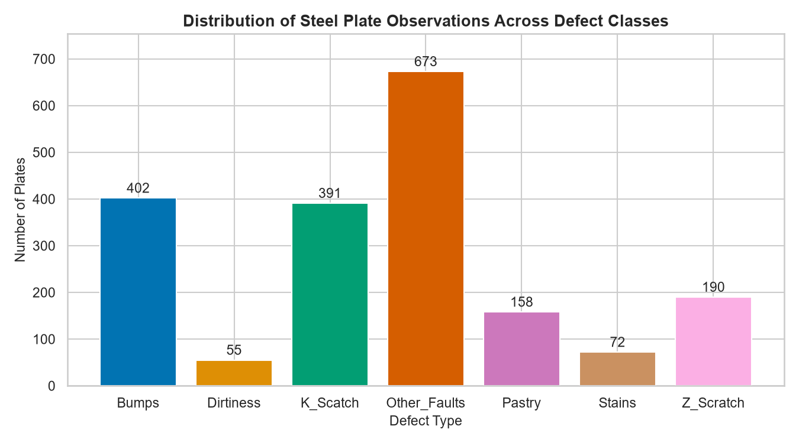

*Figure 1. Distribution of steel plate observations across defect classes.*

The bar chart makes the imbalance visible: `Other_Faults` is by far the most frequent class, followed by `Bumps` and `K_Scatch`, while `Dirtiness` and `Stains` have fewer than 100 observations each.

### 4.6 Target Variable

The seven binary defect indicator columns were converted into the single categorical target `Defect_Type`. For each row, the defect whose indicator column was set to 1 was taken as the plate's defect type.

Validation of the constructed target confirmed that every observation received exactly one label:

- Minimum labels per row = 1
- Maximum labels per row = 1
- Rows with exactly one defect label = 1941

### 4.7 Feature Correlations

The correlations between the 27 predictive features were examined with a correlation matrix and heatmap, computed on the full feature matrix.

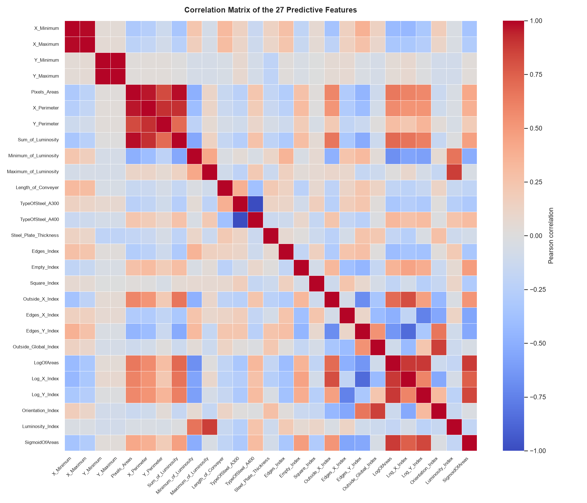

*Figure 2. Correlation matrix of the 27 predictive features.*

The heatmap shows groups of strongly correlated features. For example, the geometry-related features (`Pixels_Areas`, `X_Perimeter`, `Y_Perimeter`, `Sum_of_Luminosity`) are strongly positively correlated with each other, and the area-derived log features (`LogOfAreas`, `Log_X_Index`, `Log_Y_Index`, `SigmoidOfAreas`) are also highly correlated. This structure is expected because many features are derived from the same underlying plate measurements.

## 5. Data Preprocessing

The preprocessing performed in the project consisted of the following steps:

- Construction of the `Defect_Type` target from the seven binary defect indicator columns.
- Removal of the original seven defect indicator columns from the feature matrix.
- Separation of the data into a feature matrix `X` and a target vector `y`.
- A train/test split so that models could be evaluated on data not used for training.
- Feature scaling (standardization) applied for the SVM models, because SVMs require features to be on a comparable scale.
- Preservation of the feature order used during training for all later prediction work.

The final SVM used exactly 27 features. These 27 features and their order were saved as part of the model artifacts so that new input data could be prepared consistently with the training data.

The preprocessing applied to the SVM was specific to that model; scaling was not applied uniformly to every classifier.

## 6. Classification Models

Four classification approaches were evaluated: a Linear SVM baseline, a tuned SVM, a Decision Tree, and Naive Bayes.

### 6.1 Linear SVM Baseline

A Linear SVM was established as the baseline model for the supervised classification stage. Its performance on the test set was:

- Accuracy = 0.7326
- Precision = 0.7341
- Recall = 0.7326
- F1-Score = 0.7326

### 6.2 Tuned SVM

Hyperparameter tuning of the SVM was performed using cross-validation with grid search. The search considered different values of the regularization parameter `C` and the kernel type.

The best parameters were:

- C = 10
- kernel = RBF

The best cross-validation F1-score was 0.7621.

The tuned SVM evaluated on the held-out test set achieved:

- Accuracy = 0.7635
- Precision = 0.7672
- Recall = 0.7635
- F1-Score = 0.7644

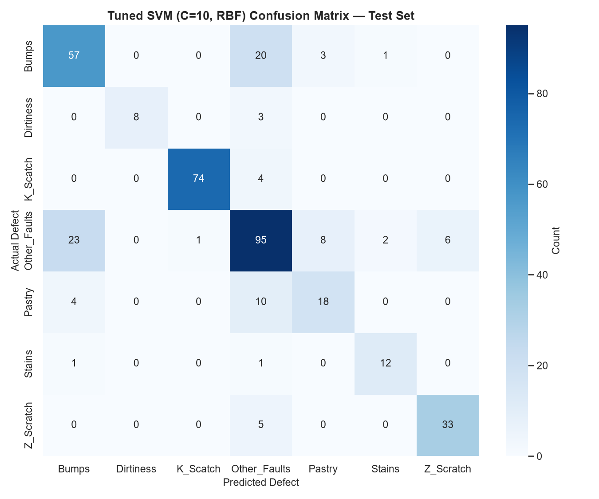

*Figure 3. Confusion matrix of the tuned RBF SVM on the test set.*

The confusion matrix shows that `K_Scatch` (74 of 78 correct) and `Stains` (12 of 14 correct) were separated very well, while the main source of confusion was between `Bumps` and `Other_Faults`: 20 `Bumps` plates were predicted as `Other_Faults` and 23 `Other_Faults` plates were predicted as `Bumps`. `Pastry` was also frequently confused with `Other_Faults`. These observations are consistent with the per-class recall values in the tuned SVM classification report.

### 6.3 Decision Tree

A Decision Tree classifier was trained and evaluated. Its test-set results were:

- Accuracy = 0.7455
- Precision = 0.7492
- Recall = 0.7455
- F1-Score = 0.7452

### 6.4 Naive Bayes

A Gaussian Naive Bayes classifier was trained and evaluated. Its test-set results were:

- Accuracy = 0.4524
- Precision = 0.5741
- Recall = 0.4524
- F1-Score = 0.4003

## 7. Classification Model Comparison

The test-set results of the four classifiers are summarized below.

| Model | Accuracy | Precision | Recall | F1-Score |
|---|---:|---:|---:|---:|
| Tuned SVM (C=10, RBF) | 0.7635 | 0.7672 | 0.7635 | 0.7644 |
| Decision Tree | 0.7455 | 0.7492 | 0.7455 | 0.7452 |
| Linear SVM | 0.7326 | 0.7341 | 0.7326 | 0.7326 |
| Naive Bayes | 0.4524 | 0.5741 | 0.4524 | 0.4003 |

The tuned RBF SVM achieved the highest accuracy and the highest F1-score among the evaluated classifiers, and it also showed the best precision and recall. Because F1-score balances precision and recall, and the tuned SVM outperformed the other models on both accuracy and F1-score, it was selected as the best classification model. No claim of statistical significance is made; the selection was based on the evaluated performance on the test set.

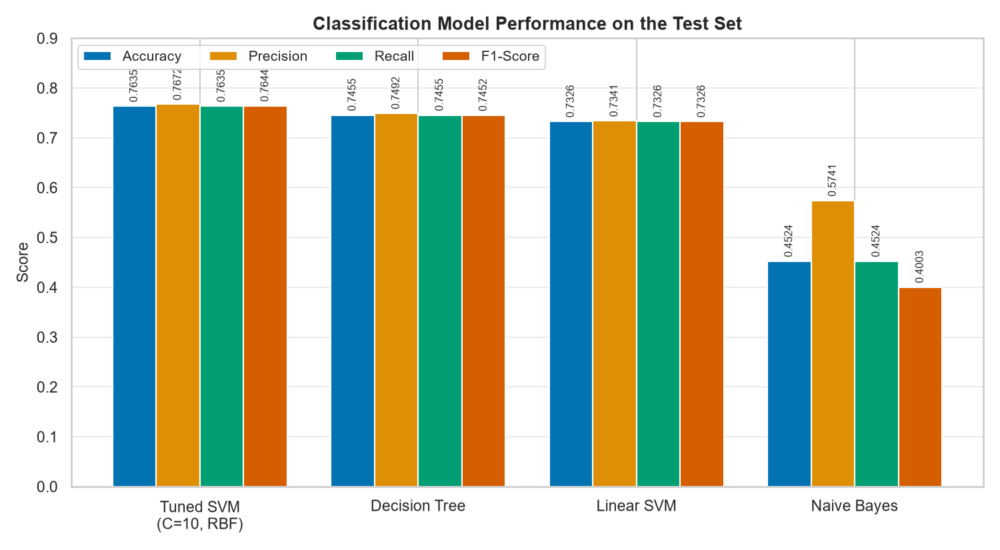

*Figure 4. Comparison of the classification models on the four evaluation metrics.*

The grouped bar chart shows that the tuned RBF SVM leads on all four metrics. The Decision Tree and the Linear SVM perform similarly to each other and slightly below the tuned SVM, while Naive Bayes is clearly the weakest model, with a particularly low F1-score.

## 8. Unsupervised Learning — K-Means Clustering

K-Means clustering was applied to explore whether the steel plates form natural groups based on their feature values. The elbow method was used to help choose the number of clusters by inspecting how the within-cluster inertia changes with the number of clusters `K`.

The inertia values computed for `K` from 2 to 10 were:

| K | Inertia |
|---:|---:|
| 2 | 40517.09 |
| 3 | 35992.05 |
| 4 | 33031.26 |
| 5 | 30969.26 |
| 6 | 27072.63 |
| 7 | 25545.85 |
| 8 | 23884.86 |
| 9 | 22597.36 |
| 10 | 21488.97 |

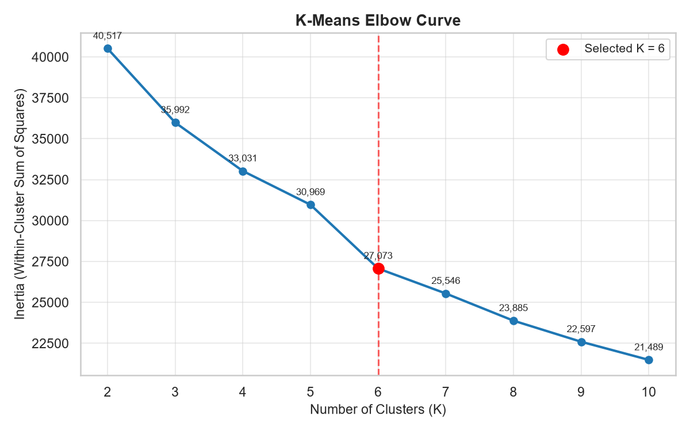

*Figure 5. K-Means elbow curve. The selected value K = 6 is highlighted.*

The inertia decreases as `K` increases, with a marked drop up to about `K = 6` and a progressively smaller decrease afterwards. In the notebook's clustering analysis, `K = 6` was selected as the number of clusters. The final K-Means model was trained with this value, producing the following cluster sizes:

| Cluster | Number of Plates |
|---:|---:|
| 0 | 444 |
| 1 | 483 |
| 2 | 125 |
| 3 | 641 |
| 4 | 1 |
| 5 | 247 |

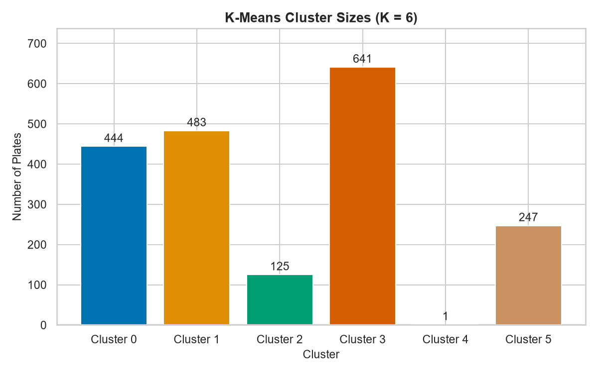

*Figure 6. Number of steel plates assigned to each cluster by the final K-Means model.*

The clusters are highly imbalanced in size: clusters 3, 1, and 0 contain most of the plates, while cluster 4 contains only a single plate and cluster 2 contains 125 plates.

The clusters were then examined against the known defect types to understand their composition, for example by identifying the dominant defect type within each cluster. This analysis described the structure found by K-Means; the clusters were not asserted to represent physically meaningful defect categories beyond what the analysis showed.

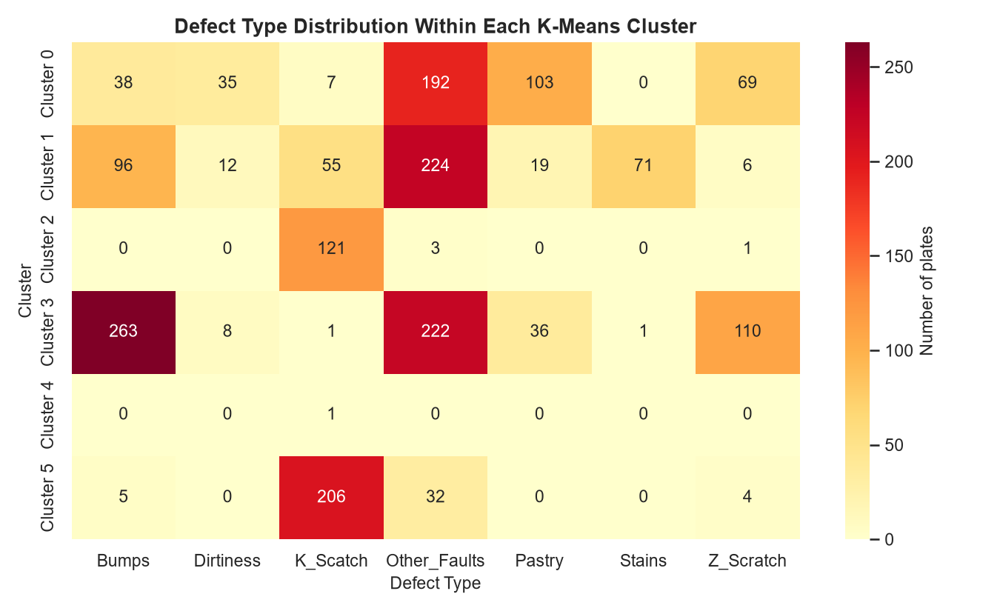

*Figure 7. Defect type distribution within each K-Means cluster (cell values are counts of plates).*

The heatmap shows that some clusters are strongly associated with particular defect types. For example, cluster 2 is dominated by `K_Scatch` (121 of 125 plates), cluster 5 is also mostly `K_Scatch` (206 of 247), cluster 3 is dominated by `Bumps`, and clusters 0 and 1 are dominated by `Other_Faults`. The single-plate cluster 4 contains one `K_Scatch` plate whose features are extreme compared with the rest of the dataset.

## 9. Outlier Detection

Potential outliers were investigated using three complementary methods:

1. Z-score
2. IQR (interquartile range)
3. Isolation Forest

### 9.1 Z-Score

The Z-score method flags a value as extreme when its standardized distance from the mean exceeds a threshold of |Z| > 3.

- Potential outliers: 211
- Percentage of observations: 10.87%

### 9.2 IQR

The IQR method flags values that fall below Q1 − 1.5 × IQR or above Q3 + 1.5 × IQR.

- Potential outliers: 824
- Percentage of observations: 42.45%

### 9.3 Isolation Forest

Isolation Forest is an algorithmic method that isolates anomalous observations.

- Potential outliers: 194
- Percentage of observations: 9.99%

### 9.4 Multi-Method Outlier Analysis

The three methods did not always agree on which observations were outliers, so the observations were examined according to how many methods flagged them.

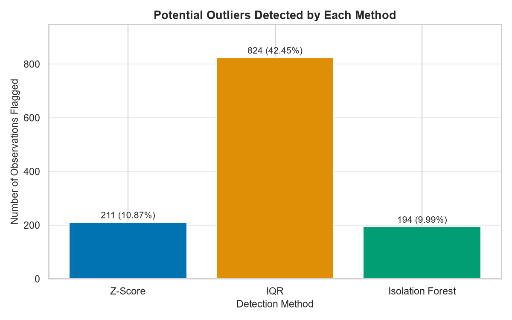

*Figure 8. Number and percentage of observations flagged as potential outliers by each method.*

The IQR method flags a much larger share of observations (42.45%) than the Z-score method (10.87%) or Isolation Forest (9.99%). This large difference means the methods should be combined rather than used in isolation.

Observations flagged by at least two of the three methods: 289.

Observations flagged by all three methods (three-method consensus): 102.

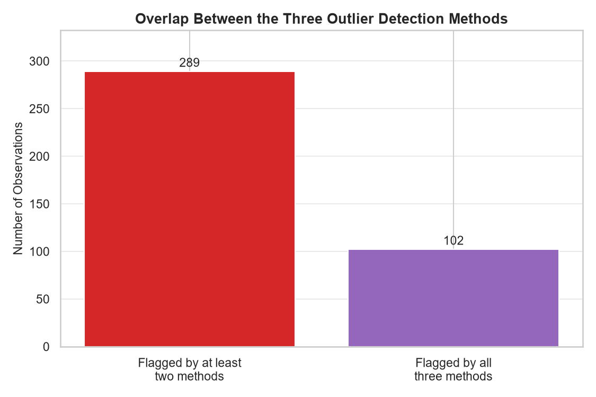

*Figure 9. Overlap between the outlier detection methods: observations flagged by at least two methods and by all three methods.*

The 102 observations flagged by all three methods were further examined by defect type:

| Defect Type | Count | Percentage |
|---|---:|---:|
| K_Scatch | 48 | 47.06% |
| Other_Faults | 44 | 43.14% |
| Pastry | 5 | 4.90% |
| Bumps | 3 | 2.94% |
| Z_Scratch | 2 | 1.96% |

The three-method set was therefore concentrated mainly in the `K_Scatch` and `Other_Faults` classes. These observations were interpreted as potential statistical or anomalous observations; not every flagged observation was necessarily a data error or a physically defective plate.

## 10. Feature Importance Analysis

A Random Forest classifier was used to estimate the importance of each feature in predicting the defect type. The ten features with the highest importance were:

| Rank | Feature | Importance |
|---:|---|---:|
| 1 | LogOfAreas | 0.073263 |
| 2 | Length_of_Conveyer | 0.061145 |
| 3 | Pixels_Areas | 0.056561 |
| 4 | Log_X_Index | 0.050015 |
| 5 | Outside_X_Index | 0.047066 |
| 6 | Steel_Plate_Thickness | 0.046919 |
| 7 | X_Minimum | 0.044496 |
| 8 | Sum_of_Luminosity | 0.042909 |
| 9 | Minimum_of_Luminosity | 0.041634 |
| 10 | Edges_Index | 0.038157 |

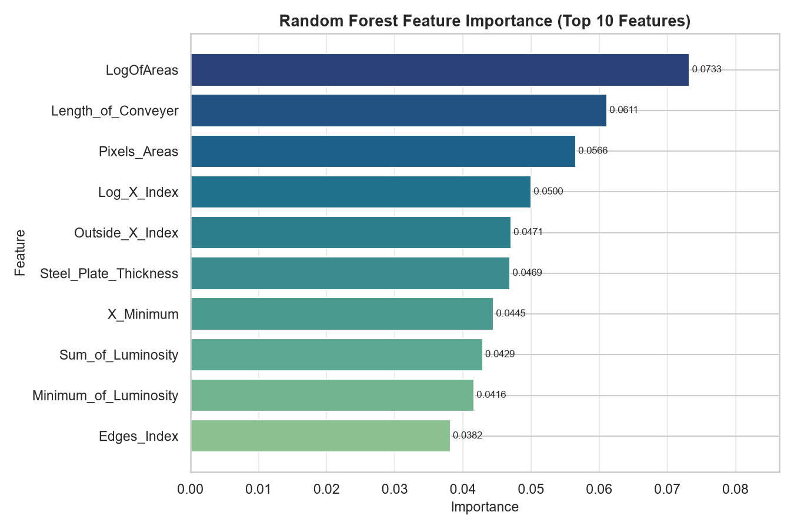

*Figure 10. Random Forest feature importance for the top 10 features (horizontal bars, highest importance on top).*

The area and geometry-related features dominate the ranking, with `LogOfAreas` and `Length_of_Conveyer` clearly ahead of the other features.

According to the notebook analysis, the top ten features accounted for approximately 50.22% of the total Random Forest feature importance. Feature importance indicates the predictive contribution of each feature within the Random Forest model; it should not automatically be interpreted as evidence of a causal relationship with the defect type.

## 11. Final Model Selection

The final classification model selected for the project was:

- Support Vector Machine with RBF kernel
- C = 10
- kernel = RBF

Its test-set performance was:

- Accuracy = 76.35%
- Precision = 76.72%
- Recall = 76.35%
- F1-Score = 76.44%

The cross-validation F1-score was 76.21%.

This model was selected because it achieved the strongest overall classification performance among the evaluated classifiers on both accuracy and F1-score.

## 12. Model Artifact and Prediction Pipeline

The final model and its preprocessing artifacts were saved under `outputs/models/`:

- `tuned_svm_model.pkl` — the final tuned SVM classifier (SVC, C=10, RBF kernel).
- `svm_scaler.pkl` — the StandardScaler fitted on the training data, used to scale new input before prediction.
- `feature_names.pkl` — the list of the 27 features in the exact order expected by the model.

An additional file, `outputs/models/scaler.pkl`, is also present. This is a LEGACY scaler. It was fitted on the full feature dataset and was not the scaler used during final SVM training. The correct SVM scaler is `svm_scaler.pkl`, which was fitted using the training data and is the scaler used for inference.

`scaler.pkl` is retained as a legacy artifact for audit/documentation purposes but is not used by the final prediction pipeline.

The inference pipeline is:

```
Input
→ validation
→ feature ordering
→ svm_scaler.transform()
→ tuned SVM prediction
→ Defect_Type
```

The prediction module validates the input before making a prediction. It checks that the input is a DataFrame, that all required features are present, that no extra features are included, that all values are numeric, that no values are missing (NaN), and that the features are used in the correct order.

## 13. Streamlit User Interface

A Streamlit application was developed at `app/app.py` to expose the trained model as an interactive prediction interface. The application provides:

- input fields for all 27 features;
- logical grouping of the inputs into related sections;
- a predict button that runs the model on the entered values;
- example input functionality that loads real observations from the dataset;
- display of the predicted defect type;
- a sidebar with information about the model; and
- a disclaimer noting that the tool is for decision support rather than a replacement for physical inspection.

The user interface is a thin layer over the reusable prediction module: it calls functions from `src/predict.py` and does not re-implement model loading, feature ordering, or scaling itself.

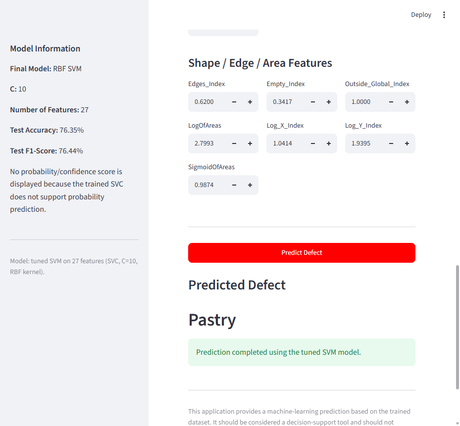

*Figure 11. The Streamlit prediction application showing the grouped feature inputs and a predicted defect result.*

The application was successfully tested in a browser. For example, dataset row 5 (actual defect: `Pastry`) was loaded through the example functionality and the application predicted `Pastry`. This single example demonstrates that the interface works end to end; it does not by itself prove the model's accuracy.

## 14. Limitations

The project has several limitations that should be kept in mind:

1. The test accuracy of the final model is approximately 76%, so predictions are not always correct.
2. The dataset has a class imbalance, and no balancing technique was applied.
3. Outlier detection identifies potential statistical anomalies, not necessarily data errors or physically defective plates.
4. The Streamlit application is a prototype/decision-support tool rather than a certified industrial inspection system.
5. The SVM does not provide probability/confidence output because the saved model was trained with `probability=False`.
6. The analysis was performed on the provided dataset and should not automatically be generalized to other steel manufacturing environments.

## 15. Conclusion

This project carried out an end-to-end machine-learning workflow for steel plate defect analysis. The dataset was inspected and prepared, the seven binary defect indicators were converted into a single `Defect_Type` target, and four classification models were trained and evaluated. The tuned RBF SVM (C=10) achieved the best overall performance, with a test accuracy of 76.35% and an F1-score of 76.44%.

In addition to classification, K-Means clustering was used to explore natural groupings of the plates, three complementary methods were applied to detect potential outliers, and Random Forest feature importance identified the features with the strongest predictive contribution.

The final SVM, its scaler, and the feature list were saved as reusable artifacts, and a prediction module was built to run the inference pipeline: validation, feature ordering, scaling, and prediction. A Streamlit user interface was developed on top of this module so that new steel plate measurements can be entered and a predicted defect type returned.

Taken together, the project demonstrates a complete, reproducible machine-learning workflow for steel plate defect analysis and prediction, from data understanding through modeling to an interactive prediction application. It does not claim industrial deployment or guaranteed defect detection.

## 16. Project Structure

The final structure of the repository is:

```
steel-plate-quality-control/
├── app/
│   └── app.py
├── data/
├── notebooks/
│   └── steel_plate_quality_control.ipynb
├── outputs/
│   ├── figures/              # report figures generated in this project
│   └── models/
│       ├── feature_names.pkl
│       ├── scaler.pkl
│       ├── svm_scaler.pkl
│       └── tuned_svm_model.pkl
├── reports/
│   └── STEEL_PLATE_QUALITY_CONTROL_LAB_REPORT.md
├── src/
│   ├── __init__.py
│   ├── extract_svm_scaler.py
│   ├── predict.py
│   ├── test_prediction.py
│   └── verify_model.py
├── README.md
├── REAL_APPLICATION_ROADMAP.md
└── requirements.txt
```

The `outputs/figures/` directory contains the report-quality figures generated for this document (for example, the defect distribution, correlation heatmap, model comparison, clustering, outlier, and feature importance figures, as well as a screenshot of the Streamlit application).

## 17. Reproducibility / Running the Application

The application can be started from the project root with:

```
.venv\Scripts\python -m streamlit run app/app.py
```

The application loads the saved model artifacts and runs predictions using the existing trained model. It does not retrain the model.
